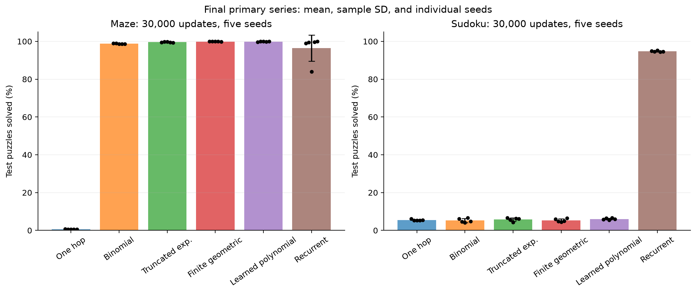

# Binomial attention: эксперименты и результаты

Публичный исследовательский снимок сравнения binomial, exponential, geometric и learned polynomial attention с one-hop и recurrent моделями на Maze и Sudoku. Завершены **60 основных и 20 дополнительных MLP-обучений по 30 000 обновлений**, по пять seeds на условие. Основной снимок от 10 октября 2026 дополнен финальными MLP-результатами 11 октября 2026.

**[Финальные результаты MLP](REPORT_MLP_FINAL_RU.md)** · **[Большой подробный отчёт на русском](REPORT_RU.md)** · **[Все таблицы запусков](docs/EXPERIMENT_TABLES_RU.md)** · **[Исходная серия CSV](results/tables/results.csv)**

В отчёте описаны данные, формулы, архитектура, инициализация, loss, выбор гиперпараметров, обучение, checkpoint/resume, измерение времени, каждый этап экспериментов, найденные ошибки и ограничения выводов.

Основная серия без внутреннего MLP:

| Метод | Maze test solved, % | Sudoku test solved, % |
| --- | --- | --- |
| One hop | 0,62 ± 0,04 | 5,49 ± 0,33 |
| Binomial | 98,76 ± 0,18 | 5,23 ± 1,08 |
| Truncated exponential | 99,58 ± 0,22 | 5,76 ± 0,94 |
| Finite geometric | 99,88 ± 0,04 | 5,34 ± 0,86 |
| Learned polynomial | 99,88 ± 0,13 | 6,05 ± 0,44 |
| Recurrent | 96,40 ± 6,94 | 94,77 ± 0,37 |

Здесь mean ± sample SD по пяти seeds. В этой постановке особое преимущество binomial не подтверждено. Рекуррентная модель отличается также числом параметров, глубиной вычисления и временем; сравнение не выделяет причинный эффект одного механизма.



Финальная серия с внутренним MLP **завершена: 20/20**. Её 24 коротких пилота остаются отдельным этапом. Ниже — финальные test-результаты, mean ± sample SD по пяти seeds.

<!-- MLP_FINAL_RESULTS_START -->
| Задача | Фильтр | Без MLP, % | С MLP, % | Δ, п.п. | 95% CI Δ, п.п. |
| --- | --- | --- | --- | --- | --- |
| maze | Binomial | 98.7600 ± 0.1817 | 99.7200 ± 0.1789 | +0.9600 | [+0.7400; +1.1800] |
| maze | Exponential | 99.5800 ± 0.2168 | 99.9400 ± 0.0894 | +0.3600 | [+0.1800; +0.5600] |
| sudoku | Binomial | 5.2278 ± 1.0799 | 38.9789 ± 1.5801 | +33.7511 | [+32.1644; +34.9556] |
| sudoku | Exponential | 5.7622 ± 0.9416 | 39.6578 ± 1.3395 | +33.8956 | [+33.3889; +34.4022] |
<!-- MLP_FINAL_RESULTS_END -->

Перепроверены 190 000 сохранённых test-предсказаний и 320 ответов лучших checkpoint; [аудит](results/audit/mlp_final_publication_audit.json) пройден. Дополнительные параметры и вычисления не выровнены с контролем: прирост нельзя приписывать только одному механизму. Прежний частичный [статус выполнения](results/metadata/execution_snapshot.json) сохранён как архив; актуальное завершение — в [MLP metadata](results/metadata/mlp_final_publication.json).

## Содержимое

- [REPORT_RU.md](REPORT_RU.md): подробный отчёт, 24 раздела.
- [src](src): исходники моделей, генераторов, обучения, проверки решений и метрик.
- [tests](tests): проверки математических операций, валидаторов и воспроизводимого продолжения.
- [results/records](results/records): конфигурации, result/evaluation JSON и validation-кривые запусков.
- [results/mlp_final/records](results/mlp_final/records):20 завершённых MLP-обучений, отдельно от прежнего частичного снимка.
- [results/tables](results/tables): агрегаты, парные различия, timing и pointer diagnostics.
- [results/protocols](results/protocols): замороженные протоколы и очереди.
- [results/audit](results/audit): результаты независимой ревизии и её ограничения.
- [PUBLICATION_MANIFEST.json](PUBLICATION_MANIFEST.json): происхождение снимка и изменения переносимых служебных скриптов.

Исходные PDF/XLSX, сторонние исходные данные, model checkpoints и массивы индивидуальных предсказаний не включены. Maze воспроизводится генератором. Sudoku использует официальный sudoku-hard из [кода Recurrent Relational Networks](https://github.com/rasmusbergpalm/recurrent-relational-networks/blob/master/tasks/sudoku/data.py). Наша recurrent-модель не повторяет архитектуру этой статьи.

## Окружение и быстрая проверка

Рабочая среда исходных запусков: Python 3.11.11, PyTorch 2.6.0+cu124, NumPy 2.2.2, NVIDIA A100-SXM4-80GB. Точные сведения сохранены в [gpu_environment.json](results/metadata/gpu_environment.json).

```bash
python3 -m venv .venv
source .venv/bin/activate
python -m pip install -e .
python -m pytest
python scripts/build_mlp_final_assets.py
python scripts/build_public_assets.py
python scripts/check_public_snapshot.py
python scripts/check_mlp_final_snapshot.py
```

На вычислительном кластере выполняйте tests, подготовку данных и построение рисунков внутри CPU allocation, а обучение — внутри GPU allocation. `requirements.lock` — архивный перечень пакетов объединённого контейнера и venv; в нём есть повторяющиеся версии pip/setuptools. Он сохранён как свидетельство окружения и не является готовым входом для `pip install -r`. Установка через pyproject обеспечивает запуск, но сама по себе не гарантирует побитное совпадение с историческим окружением.

Проверить полный путь на маленьком синтетическом Maze можно так:

```bash
python -m transport_reasoning prepare-data --config configs/cpu_smoke_maze.json
python -m transport_reasoning train --config configs/cpu_smoke_maze.json
```

Новые артефакты пишутся в `experiments/transport_reasoning`; опубликованные `results` остаются архивом. Запускайте команды из корня репозитория: вычисление source hash использует относительные пути `src`.

## Повторное обучение финальной конфигурации

Все фактически использованные конфигурации находятся рядом с метриками в `results/records`. Например, Maze/binomial/seed 71:

```bash
python -m transport_reasoning prepare-data --config results/records/maze/binomial/0cf228f2a68c50e7/seed_71/config.json
python -m transport_reasoning train --config results/records/maze/binomial/0cf228f2a68c50e7/seed_71/config.json
```

Вторая команда требует CUDA и действующий Slurm allocation; автоматического заказа GPU она не делает. Пример с ресурсами, заданными пользователем:

```bash
srun --account="$TRANSPORT_ACCOUNT" --partition="$TRANSPORT_GPU_PARTITION" \
  --gres=gpu:1 --cpus-per-task=4 --mem=48G --time=02:00:00 \
  .venv/bin/python -m transport_reasoning train \
  --config results/records/maze/binomial/0cf228f2a68c50e7/seed_71/config.json
```

Для Sudoku скачайте sudoku-hard по ссылке из официального upstream-кода, распакуйте `train.csv`, `valid.csv`, `test.csv` в одну директорию и задайте `TRANSPORT_RRN_DIR` её путём. Файлы должны содержать 180 000 / 18 000 / 18 000 строк. SHA-256 исходных CSV и manifest приведены в [протоколе](results/protocols/mlp_final_protocol.json). Поля train_count/val_count/test_count в старых RRN-конфигах не ограничивают эти CSV: фактические размеры исправлены в сводных таблицах и подробно разобраны в отчёте.

Выберите Sudoku config из `results/records/sudoku`, затем выполните те же `prepare-data` и `train`. Во время train выполняются validation и выбор лучшего checkpoint. После завершения всех 30 000 обновлений выполните test отдельно; для приведённого выше Maze-примера команда такая:

```bash
python -m transport_reasoning evaluate \
  --config results/records/maze/binomial/0cf228f2a68c50e7/seed_71/config.json \
  --checkpoint experiments/transport_reasoning/runs/maze/binomial/0cf228f2a68c50e7/seed_71/checkpoint_best.pt \
  --split test
```

Команда evaluate также исполняется внутри GPU allocation для CUDA-конфигурации. Для resume используется `train --config ... --resume <checkpoint_last.pt>`; для старых запусков необходимы не включённые сюда веса. Из CSV восстановить состояние optimizer невозможно.

## Служебные скрипты и границы воспроизводимости

`scripts/cpu_prepare.py` и `scripts/pointer_bridge.py` сохранены как исторические оркестраторы и ожидают исходные документы в `/inputs`. Первый также устанавливает зависимости и готовит всю кампанию. Они не являются входной командой для публичной копии без этих документов. Ядро pointer-задачи доступно в [data/pointer.py](src/transport_reasoning/data/pointer.py), а весь обучающий цикл — в `pointer_bridge.py`; исторический workbook audit выполняется после него и требует исходный XLSX.

Для продолжения уже начатой приватной кампании использовались `mlp_final_campaign.py`, `audited_mlp_runtime.py`, `chunked_mlp_runtime.py` и `mlp_chunk_scheduler.py`. Они ожидают полный рабочий каталог с бюджетом, протоколами, данными и checkpoint. Публичный снимок сам по себе таким каталогом не является. Перед переносом задайте `TRANSPORT_ROOT`, `TRANSPORT_INPUTS`, `TRANSPORT_IMAGE`, `TRANSPORT_ACCOUNT`, `TRANSPORT_GPU_PARTITION`, `TRANSPORT_CPU_PARTITION` и проверьте политику своего scheduler. Исторический dispatcher не следует запускать вслепую как команду новой кампании.

Архивный аудит заново проверил 570 000 сохранённых test-предсказаний и повторил inference на 960 примерах из checkpoints. Эти исходные массивы и веса не опубликованы; публичная проверка сверяет скаляры evaluation JSON, конфигурации, hashes, validation-кривые, выбор best checkpoint и агрегаты. [Результат проверки публичного снимка](results/metadata/publication_validation.json) описывает этот более узкий объём проверки.

MLP final для binomial/exponential завершён. Нерешённые пункты — OOD Maze, dense controls, parameter-matched и equal-wall-time controls, MLP final для других фильтров, полная Sudoku symmetry/uniqueness certification — перечислены в отчёте. Успешная техническая проверка не означает завершения всего исходного плана.
