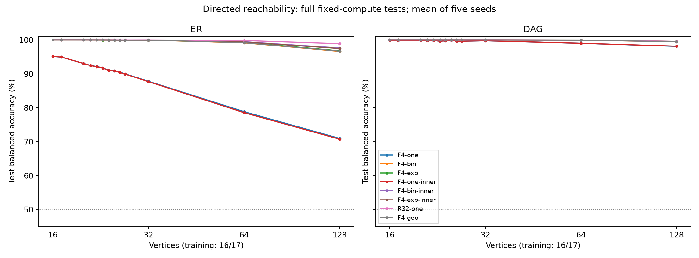
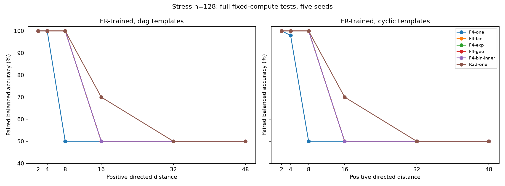
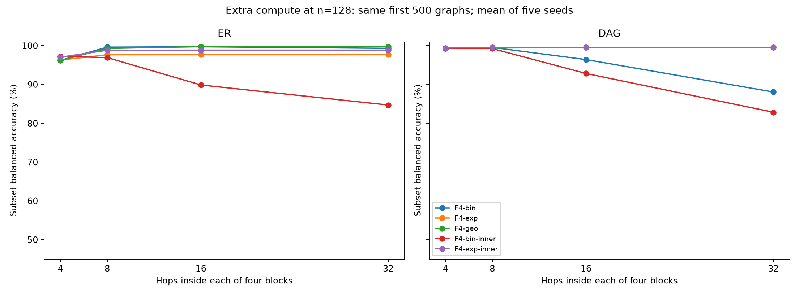

# Directed graph reachability: итоговый отчёт, 12 октября 2026

**Серия завершена в допущенном составе:** 48 пилотных/подтверждающих обучений,
80 финальных обучений, 480 полных fixed-compute и 920 дополнительных
extra-compute оценок. Базовые методы и постобработка тоже завершены.
На момент проверки очередь Жореса пуста. Срез сохранён **12 октября 2026
в 16:11:08 UTC / 19:11:08 МСК**. Израсходовано **20,356 GPU-часа из 24**.

Основной результат: на случайных ER-графах с 128 вершинами binomial получает
**96,64% balanced accuracy против 70,97% у one-hop**. Exponential и geometric
дают сходное качество, recurrent — 98,91%. Однако высокая точность на больших
случайных графах не означает устойчивого решения длинных путей: stress-набор
показывает выраженные ограничения всех моделей при исходном объёме вычислений.

Отдельно подтверждён полезный, но ограниченный эффект дополнительного вычисления:
ER-trained binomial при r=32 решает ациклические stress-цепочки длины 48
с BA 100% на заранее заданной подвыборке, но на циклической версии той же
длины остаётся на 50%. Общего превосходства биномиального фильтра на всех
режимах эти результаты не устанавливают.

Это финальное обновление [промежуточного отчёта 77/80](REPORT_GRAPHS_PROGRESS_RU.md).
Все пять seeds сохранены, включая отрицательные результаты. Код обучения,
данные, checkpoints и настройки моделей при подготовке отчёта не менялись.

## 1. Что именно завершено

| Этап | Завершено | Состав |
|---|---:|---|
| LR-пилоты | 32/32 | 8 моделей × 2 семейства × 2 learning rates, seed 101 |
| Подтверждение LR | 16/16 | 8 моделей × 2 семейства, seed 103 |
| Финальные обучения | 80/80 | 8 моделей × 2 семейства × 5 seeds |
| Полные fixed-compute оценки | 480/480 | ID, near, три far-размера, stress для каждого финала |
| Extra-compute оценки | 920/920 | Заранее заданные размеры фильтра/число повторений и подвыборки |
| Базовые методы | 72 строки | 6 методов × 2 семейства × 6 validation/test-наборов |

Пять финальных seeds: **11, 23, 37, 53, 71**. Каждый финал обучен с нуля
на 30 000 обновлений. Первоначальная полная сетка содержала девять моделей,
54 пилота и 90 финалов. До доступа к test по профилированию в бюджет была
допущена восьмимодельная сетка; **F4-learned не запускался в финальной серии**.
Таким образом, выполнена вся допущенная сетка, но не исходная девятимодельная.
Остаток бюджета не использовался для добавления моделей после просмотра test.

Последнее GPU-задание, учёт ресурсов и CPU-постобработка имеют
`COMPLETED`, exit code `0:0`. Все выделения графовой GPU-очереди учтены:
73 283 секунды = 20,3564 GPU-часа. В счётчик включены её preflight,
profile, пилоты, финалы, evaluation и накладные расходы. Новые CPU-проверки
публикации выполнялись отдельно и не расходовали GPU-время.

## 2. Постановка и данные

Задача: для ориентированного графа и запроса (s,t) предсказать, существует ли
путь s → t. Это бинарная классификация запросов, а не восстановление пути.
ER и DAG — два независимых семейства; для каждого обучались отдельные модели.

Генераторы сохраняют все n вершин, включая изолированные. ER задаёт
вероятность ребра p=d₀/(n−1), d₀∈{1;1,5;2}; self-loops в исходном графе нет.
DAG сначала ограничивает рёбра верхним треугольником, затем случайно
перенумеровывает вершины; d₀∈{1;1,5;2;2,5;3}. Скрытый порядок DAG не является
признаком. Из-за ограничения треугольником эти семейства не имеют одинаковой
плотности при одном d₀ и не должны смешиваться в одной средней метрике.

| Split | Размеры n | Графов на семейство | Запросов на семейство |
|---|---|---:|---:|
| Train | 16, 17 | 100 000 | 800 000 |
| Validation | 18, 19 | 5 000 | 40 000 |
| Test ID | 16, 17 | 5 000 | 40 000 |
| Test near | 20–27 | 20 000 | 160 000 |
| Test far | 32, 64, 128 | 6 000 | 48 000 |

Всего **272 000 случайных графов и 2 176 000 запросов**, дополнительно
6000 stress-шаблонов и 12 000 запросов. На случайный граф приходится восемь
разных равномерных упорядоченных запросов s≠t без балансировки классов.
Все запросы графа находятся в одном split. Метки и расстояния вычислены
directed BFS; проверки генерации включали независимое транзитивное замыкание.

Stress-набор строится из двух цепочек с парой запросов к одной цели:
один источник достижим, другой недостижим. Конструкция согласует степени
источников и принадлежность слабой компоненте, чтобы простые локальные
подсказки не решали пару автоматически. Есть DAG- и cyclic-варианты,
добавочные вершины и случайная перенумерация. Размеры n=16/32/64/128,
длины ℓ=2/4/8/16/32/48 при условии 2(ℓ+1)≤n; 200 шаблонов на допустимую
ячейку n/ℓ/variant, два запроса на шаблон. Всего 30 таких ячеек.

Пять входных признаков: константа, source/target markers,
log(1+indegree), log(1+outdegree). Readout читает только target.
При Bᵢⱼ=1 для ребра i→j внимание использует маску **I∨Bᵀ**:
информация приходит к вершине по входящим рёбрам. Labels, расстояния,
component IDs и скрытый DAG rank в forward не передаются; глобального
pooling и virtual token нет.

## 3. Архитектуры и обучение

F4 — четыре независимых блока, width 128, четыре головы. One-hop использует
AV. При обучении фильтров r=4; биномиальный фильтр равен

\[
Y=(4AV+6A^2V+4A^3V+A^4V)/15.
\]

Exponential и geometric смешивают те же четыре степени с положительными
нормированными коэффициентами. Их параметры при r=4 выбраны так, чтобы
средний индекс переноса совпадал с binomial, 32/15. A фиксирована внутри
блока, но дифференцируема; следующий блок вычисляет её заново.

Варианты `inner` добавляют внутренний MLP с коэффициентом 0,1 после каждого
переноса. F4-one-inner включён как контроль. R32-one повторяет один общий
блок 32 раза, пересчитывая внимание и применяя внешний FFN на каждом шаге.
Поэтому R32 отличается от F4 не только способом смешивания степеней.

Параметров: **792 193** у F4 без inner, **925 313** с inner и **198 913** у R32.
Максимум последовательных переносов при исходном вычислении: 4 у one-hop,
16 у четырёхблочных фильтров и 32 у R32. Это предел зависимости представления
от удалённых вершин, а не обещание корректного решения любого пути этой длины.

AdamW, batch 64, weight decay 0,01, clipping 1, float32, TF32 выключен;
warmup 1500 шагов и cosine horizon 30 000; unweighted BCEWithLogits.
Learning rate 0,0003 или 0,001 выбирается отдельно для model/family по полной
validation в конце пилота seed101: максимум BA, минимум BCE, меньшая ставка.
Seed103 подтверждает выбор. Пилоты выполняют 3000 обновлений, сохраняя
горизонт scheduler 30 000.

Validation финалов — каждые 1000 шагов. Лучший checkpoint выбирается по
максимуму BA, затем минимуму BCE, затем самому раннему шагу. Все 80 финалов
закончились и их лучшие checkpoints были зафиксированы **до test**.
Тестовые оценки ниже используют именно эти checkpoints; прежняя промежуточная
таблица использовала validation на последнем шаге. Это разные типы результатов.

## 4. Основные test-результаты при исходном вычислении

Основная метрика — **balanced accuracy**:
BA=½×(recall положительного класса + specificity отрицательного).
Обычная accuracy также сохранена, но при редком положительном классе
может создавать ложное впечатление хорошего решения.

Таблица показывает **mean ± sample SD, проценты, по пяти seeds**, на полном
far-test n=128: 2000 графов и 16 000 запросов на семейство. Это теперь
настоящий test, не validation.

| Модель | ER n=128, BA % | DAG n=128, BA % |
|---|---:|---:|
| F4-one | 70,967 ± 0,716 | 98,121 ± 0,075 |
| F4-bin | 96,636 ± 0,463 | 99,497 ± 0,000 |
| F4-exp | 96,796 ± 0,352 | 99,530 ± 0,075 |
| F4-one-inner | 70,738 ± 0,232 | 98,154 ± 0,000 |
| F4-bin-inner | 97,625 ± 0,804 | 99,497 ± 0,000 |
| F4-exp-inner | 97,469 ± 0,848 | 99,564 ± 0,150 |
| R32-one | 98,909 ± 0,932 | 99,564 ± 0,092 |
| F4-geo | 96,699 ± 0,456 | 99,497 ± 0,000 |

На ER разность binomial − one-hop составляет **+25,669 п.п.**,
exploratory paired-seed bootstrap 95% CI **[25,002; 26,236] п.п.**.
На DAG разность меньше: **+1,376 п.п.**, CI **[1,342; 1,443]**.

На ER exponential − binomial: +0,160 п.п., CI [−0,260; +0,636];
geometric − binomial: +0,064 п.п., CI [−0,353; +0,706]. Эти интервалы
не подтверждают особого преимущества одной из трёх форм фильтра при r=4.
R32 − binomial: **+2,273 п.п.**, CI [1,230; 3,141], но R32 имеет другую
архитектуру и существенно больше последовательного вычисления.

Inner MLP в этом test помогает binomial на ER: **+0,989 п.п.**,
CI [0,594; 1,436], при дополнительных параметрах и времени.
Для exponential прирост +0,673 п.п., CI [−0,085; +1,430].
На DAG для binomial прироста от inner нет в наблюдаемой BA.
Нельзя переносить эффект inner MLP автоматически на все семейства и режимы.

Интервалы построены по парным разностям пяти обучающих seeds с точным
перебором 3125 эмпирических bootstrap-выборок. Они описательные,
без поправки на множественные сравнения, условные на общий test-набор.
Это не интервалы по новым графам; пять обучений не заменяют независимые
датасеты. Все парные сравнения сохранены в CSV.

## 5. Как меняется качество с размером

В следующей таблице — средние BA, %. ID и near усреднены сначала по размерам
внутри seed, затем по пяти seeds; far-размеры показаны по отдельности.

| Семейство / модель | ID 16–17 | Near 20–27 | Far 32 | Far 64 | Far 128 |
|---|---:|---:|---:|---:|---:|
| ER / F4-one | 95,04 | 91,49 | 87,82 | 78,86 | 70,97 |
| ER / F4-bin | 100,00 | 99,97 | 99,95 | 99,16 | 96,64 |
| ER / F4-exp | 100,00 | 99,98 | 99,95 | 99,26 | 96,80 |
| ER / F4-geo | 100,00 | 99,98 | 99,95 | 99,19 | 96,70 |
| ER / F4-bin-inner | 100,00 | 99,98 | 99,97 | 99,48 | 97,62 |
| ER / R32-one | 100,00 | 100,00 | 100,00 | 99,81 | 98,91 |
| DAG / F4-one | 99,87 | 99,77 | 99,76 | 99,02 | 98,12 |
| DAG / F4-bin | 100,00 | 100,00 | 100,00 | 99,91 | 99,50 |
| DAG / F4-exp | 100,00 | 100,00 | 100,00 | 99,96 | 99,53 |
| DAG / F4-geo | 100,00 | 100,00 | 100,00 | 99,91 | 99,50 |
| DAG / F4-bin-inner | 100,00 | 100,00 | 100,00 | 99,95 | 99,50 |
| DAG / R32-one | 100,00 | 100,00 | 100,00 | 99,96 | 99,56 |



На ER one-hop заметно теряет качество с ростом n. Многошаговые F4 сохраняют
более высокую точность, но тоже ухудшаются; R32 лучше остальных в данном
сравнении при n=128. Высокие scores DAG требуют дополнительной интерпретации:
в полном DAG n=128 test всего **298 положительных запросов из 16 000**
(1,8625%), причём нет положительных путей длиной больше восьми.
В ER n=128 положительных 5187 (32,41875%), из них 1034 имеют длину 9–16
и 30 — длину 17–32. Поэтому одинаковый n не означает одинаковую трудность
по длине передачи информации.

В частности, тривиальный always-negative имеет обычную accuracy 98,1375%
на DAG n=128, но BA лишь 50%. Наши выводы выше используют BA.

## 6. Stress: длинные пути остаются проблемой

На n=128, для **ER-trained** моделей, полный stress-test даёт такие
средние BA по пяти seeds. В таблице — ациклический вариант; все числа — %.

| Модель | ℓ=2 | ℓ=4 | ℓ=8 | ℓ=16 | ℓ=32 | ℓ=48 |
|---|---:|---:|---:|---:|---:|---:|
| F4-one | 100,0 | 100,0 | 50,0 | 50,0 | 50,0 | 50,0 |
| F4-bin | 100,0 | 100,0 | 100,0 | 50,0 | 50,0 | 50,0 |
| F4-exp | 100,0 | 100,0 | 100,0 | 50,0 | 50,0 | 50,0 |
| F4-geo | 100,0 | 100,0 | 100,0 | 50,0 | 50,0 | 50,0 |
| F4-bin-inner | 100,0 | 100,0 | 100,0 | 50,0 | 50,0 | 50,0 |
| F4-exp-inner | 100,0 | 100,0 | 100,0 | 50,0 | 50,0 | 50,0 |
| R32-one | 100,0 | 100,0 | 100,0 | 70,0 | 50,0 | 50,0 |

У binomial/exp/geo и их inner-вариантов переход к ℓ=16 приводит к 50% BA,
хотя теоретический максимум последовательных переносов F4-фильтра равен 16.
Радиус зависимости сам по себе не гарантирует, что обучение при малых n
научило модель использовать все эти переносы с нужной точностью.
У R32 на ℓ=16 среднее 70%, а на ℓ=32/48 — 50%.



На DAG-trained моделях перенос к этим шаблонам ещё слабее: при n=128,
ℓ=8 в DAG-шаблонах binomial/exp/geo и R32 дают 60% BA; exp-inner — 80%.
При ℓ≥16 все рассмотренные модели с исходным вычислением дают 50%.
Средняя BA по всему stress-набору может скрывать это, поскольку включает
много более простых коротких ячеек. Полные n/ℓ/variant/seed результаты сохранены.

Здесь положительный и отрицательный запросы составляют пару на одном графе.
BA усредняет правильность отдельных запросов; это **не доля шаблонов,
у которых одновременно правильно отвечены оба запроса**.

## 7. Дополнительное вычисление без переобучения

Для bin/exp/geo заранее задана сетка r=4/8/16/32, для R32 — 32/64/128
повторений общего блока. Веса не переобучались. У exp/geo параметры λ/ρ
остаются теми, что выбраны при r=4; нормировка применяется к новому
конечному ряду. У binomial при изменении r меняются сами биномиальные
коэффициенты и средняя дальность переноса. Поэтому увеличение r не означает
одинакового изменения фильтра у всех трёх методов.

Extra-compute использует **первые 500 графов каждого far n** и **первые
50 шаблонов каждой stress-ячейки** из заранее зафиксированного порядка.
Сравнивать строки ниже нужно с r=4 на той же подвыборке, а не с full-test
из раздела 4. Для n=128 это 4000 запросов на семейство.

ER-trained модели, far n=128, **mean ± sample SD, %**:

| Модель | r=4 | r=8 | r=16 | r=32 |
|---|---:|---:|---:|---:|
| F4-bin | 96,22 ± 0,42 | 99,63 ± 0,20 | 99,73 ± 0,59 | 99,33 ± 1,48 |
| F4-exp | 96,30 ± 0,36 | 97,66 ± 0,36 | 97,67 ± 0,35 | 97,67 ± 0,35 |
| F4-geo | 96,21 ± 0,47 | 99,30 ± 0,30 | 99,77 ± 0,14 | 99,79 ± 0,15 |
| F4-bin-inner | 97,25 ± 0,97 | 96,93 ± 6,73 | 89,87 ± 22,29 | 84,70 ± 22,54 |
| F4-exp-inner | 97,04 ± 0,95 | 98,83 ± 0,63 | 98,85 ± 0,62 | 98,85 ± 0,62 |

Binomial на ER заметно выигрывает от r=8/16; geometric также улучшается.
Exponential с фиксированной λ быстро выходит на плато. Эти результаты
позволяют описать зависимость от r, но не выбрать «лучший r» по test как
новую подтверждённую настройку для будущего эксперимента.

Рост r не всегда безопасен для качества. На ER binomial+inner ухудшается
до **84,70 ± 22,54%** при r=32. На DAG plain binomial меняется от
99,25% при r=4 до 99,55% при r=8, 96,42% при r=16 и **88,06% при r=32**.
Binomial+inner на DAG при r=32 даёт 82,84%. Неограниченное повторение
выученного на r=4 преобразования не гарантирует улучшения.



Для R32 на ER той же подвыборки BA при 32/64/128 повторениях:
**98,70 ± 1,12 / 99,31 ± 1,15 / 99,35 ± 1,22%**.
На DAG: 99,55 / 99,85 / 98,96%. Это также не монотонная гарантия улучшения.

Особенно показателен stress n=128, ℓ=48 для ER-trained моделей:

| Модель и вычисление | DAG-шаблоны, BA % | Cyclic-шаблоны, BA % |
|---|---:|---:|
| Binomial, r=32 | 100,0 ± 0,0 | 50,0 ± 0,0 |
| Exponential, r=32 | 50,0 ± 0,0 | 50,0 ± 0,0 |
| Geometric, r=32 | 50,0 ± 0,0 | 50,0 ± 0,0 |
| Binomial+inner, r=32 | 80,0 ± 27,39 | 80,0 ± 27,39 |
| R32, 128 повторений | 50,0 ± 0,0 | 50,0 ± 0,0 |

Все строки — одна заранее заданная подвыборка, пять seeds; это часть
широкой предписанной сетки, а не отдельный подтверждающий эксперимент.
Результат указывает на конкретный режим, где биномиальное расширение полезно,
и одновременно показывает его ограничение при циклах. Из этой ячейки
нельзя вывести универсальное алгоритмическое решение достижимости.

## 8. Базовые методы

На полном n=128 test, BA, %:

| Метод | ER | DAG |
|---|---:|---:|
| Всегда отрицательный / всегда положительный | 50,00 | 50,00 |
| Проверка прямого ребра s→t | 51,89 | 71,81 |
| Общая слабая компонента | 63,46 | 73,12 |
| Logistic по степеням, n и числу рёбер | 75,97 | 52,11 |
| Directed BFS oracle | 100,00 | 100,00 |

Logistic использует log1p входящей/исходящей степени s и t, n и числа рёбер;
нормировка оценивается только на train. L2=0,001 фиксирована заранее,
Newton до 50 итераций, без подбора по test. У baseline есть глобальные
агрегаты n и число рёбер, которых нет в target-only one-hop readout, поэтому
его преимущество над one-hop на ER — полезный контроль, но не чистое
сравнение выразительности при одинаковых входах.

BFS oracle здесь проверяет соответствие ответов меткам BFS, проверенным
при генерации; это не новое измерение скорости BFS и не обученный baseline.
Для жёстких правил BCE не выдумывается: в таблицах она отсутствует.

## 9. Цена результата

Для ER финалов среднее накопленное время обновления весов составляет
327,7 с у one-hop, 382,4 с у binomial, 389,8 с у exponential, 397,3 с у geometric,
668,1 с у binomial+inner и 1552,4 с у R32. Полное время вызова обучения
с validation и checkpoint I/O хранится отдельно; ожидание scheduler
в эти величины не включено.

Все модели получили одинаковые 30 000 обновлений, но не одинаковое время
и не одинаковое число операций. Поэтому преимущество R32 по far-test
нельзя приписывать одному изменению фильтра. Inner MLP также увеличивает
параметры и стоимость. Equal-wall-time и parameter-matched обучения
в этой серии отсутствуют.

Сохранены измерения inference на NVIDIA A100-SXM4-80GB, batch1/batch64,
с 10 прогревами и 30 повторами: forward median, квартильные интервалы,
end-to-end median, throughput и память. End-to-end включает построение
признаков/маски фиксированных синтетических графов, перенос данных, forward
и выдачу ответа; генерация графов исключена. Время batch64/64 не называется
latency одиночного запроса. Все режимы, включая extra-compute, есть в
архивном `timing.csv`; это измерения конкретного окружения.

## 10. Аудит и исправление сводной таблицы

Независимая CPU-проверка успешно пересчитала **24 250 000 сохранённых
предсказаний** из всех **1400** NPZ-файлов. В это число входят повторные
оценки одних и тех же графов разными моделями и режимами; это не число
уникальных тестовых примеров.

Проверены метки, graph/query IDs, размеры и вспомогательные метаданные
против зафиксированного датасета; confusion matrix, BA, accuracy, precision,
recall, specificity, F1, AUROC, average precision и BCE; 11 030 строк
по размерам/stress-ячейкам и 15 400 строк по длинам путей/типам отрицательных
запросов. Сверены hashes всех 80 выбранных checkpoints и их шаги.

Отдельная проверка публикации подтвердила 2094 исходных файла снимка,
128 завершённых обучающих записей, 2688 validation-точек, выбор LR и checkpoint,
полноту всех тестовых режимов и пяти seeds, а также совпадение 30 файлов
опубликованного научного кода с исполняемой версией. Новое обучение,
новый inference и повторный BFS всех графов при этом не запускались.

**Найдена ошибка только в агрегации серверного отчёта:** для строки
`test_far, n=macro` три размера × пять seeds объединялись как 15 наблюдений.
Из-за этого `seed_count` был 15, а SD отражала одновременно размеры и seeds.
В новой основной таблице сначала усредняются n=32/64/128 внутри каждого
seed, затем считаются mean и sample SD по пяти seeds. Средняя BA сохраняется
при равных весах, SD и число независимых обучений исправлены.

Исходные предсказания, оценки отдельных n и обучение не менялись.
Архивный серверный CSV оставлен дословно для проверяемости;
актуальные сводки находятся в `tables` на верхнем уровне финального снимка.
Описательная сводка far/macro не используется как 15-seed статистика.
См. [описание исправления](results/reachability_final_20261012/aggregation_correction.json).

## 11. Ограничения выводов

Точные повторы adjacency между split исключены, но изоморфный аудит нашёл
train-топологию у **3/5000 ER ID-test** и **610/5000 DAG ID-test** графов.
ID-test не является полностью новым набором топологий. Near/far имеют
другие размеры n; там этот конкретный вид совпадения исключён разницей n.

Запросы одного графа зависимы, seeds используют один test-набор, а интервалы
выше отражают вариацию обучения. Новые graph-bootstrap интервалы для всех
итоговых сравнений не рассчитывались. Нулевой SD у некоторых строк означает
одинаковые наблюдаемые scores, а не отсутствие неопределённости на новых данных.

Natural far-test и stress отвечают на разные вопросы. Большие n в sparse DAG
не обеспечивают наличия длинных достижимых путей; stress специально создаёт
такие пути и меняет структуру графов. Поэтому одновременно возможны почти
100% BA на random DAG и 50% на длинных stress-цепочках.

Увеличение r меняет распределение коэффициентов и число операций; это не
сравнение при одинаковом времени. Отдельные удачные test-ячейки не превращают
выбранную после просмотра настройку в заранее подтверждённую рекомендацию.
Learned polynomial отсутствует в допущенной сетке. Серия является адаптацией
генераторов к query-conditioned задаче и не воспроизводит scores исходной
работы о directed graph transformers.

В пределах этой постановки поддерживаются три вывода: многошаговая передача
существенно лучше one-hop переносится на случайные ER-графы; при исходном r=4
binomial не выделяется устойчивым превосходством над exp/geo; дополнительное
биномиальное вычисление полезно в некоторых длинных ациклических шаблонах,
но имеет выраженные ограничения на других структурах и с inner MLP.

## 12. Артефакты и воспроизведение

- [Итоговые fixed-compute сводки](results/reachability_final_20261012/tables/fixed_test_aggregate.csv)
  и [все seeds](results/reachability_final_20261012/tables/fixed_test_per_seed.csv).
- [Extra-compute сводки](results/reachability_final_20261012/tables/extra_subset_aggregate.csv)
  и [все seeds/ячейки](results/reachability_final_20261012/tables/extra_subset_per_seed.csv).
- [Парные разности и интервалы](results/reachability_final_20261012/tables/paired_test_differences.csv).
- [Время и validation финальных обучений](results/reachability_final_20261012/tables/training_per_seed.csv),
  [пилоты](results/reachability_final_20261012/tables/pilots_and_confirmation.csv),
  [базовые методы](results/reachability_final_20261012/tables/baselines.csv).
- [Метрики без усреднения по размерам](results/reachability_final_20261012/tables/evaluation_pooled_metrics.csv).
- [Архивные измерения inference](results/reachability_final_20261012/reachability/runtime_report/timing.csv)
  и [срезы по длинам путей](results/reachability_final_20261012/reachability/runtime_report/path_length_slices.csv).
- [Аудит сохранённых предсказаний](results/reachability_final_20261012/prediction_audit.json),
  [проверка публикации](results/reachability_final_20261012/publication_validation.json),
  [снимок с hashes файлов](results/reachability_final_20261012/snapshot.json).
- [Исходные config/result/evaluation JSON и кривые](results/reachability_final_20261012/reachability/records).

Научный код: [ветка directed_reachability_v1](https://github.com/Kilkaintomat/binomial-attention-experiments/tree/directed_reachability_v1),
commit `2a10b8a8e56c7c04012ef8cdea3e164a9f9cf048`.
Source hash: `a98bc726b261c66a552a50b3fcf5e7dc165f7ba3fe12a52a722fe377ba9a8ed8`.
Data hash: `cf5ce937d591c8eea2e497f3bcef3bb111c2a7a9f5a2f6e5bfdaeb54921b0155`.

Таблицы и рисунки можно воспроизвести из опубликованных записей в CPU allocation:

```bash
python scripts/build_reachability_final.py
```

Нужны NumPy и Matplotlib. Необязательный `--source <scientific-checkout>`
дополнительно сверяет файлы научной ветки. Полный повтор аудита предсказаний
требует исходных NPZ, checkpoints и датасета, оставленных на сервере:
`scripts/audit_reachability_predictions.py --source <scientific-checkout>`
с соответствующими PYTHONPATH и REACH_DATA. Это не команда нового обучения.

В git не включены исходные датасеты, checkpoints, индивидуальные предсказания,
личные настройки сервера и пользовательские вложения. Их hashes и результаты
проверок опубликованы. Старые отчёты и исходные протоколы сохранены как архив.
