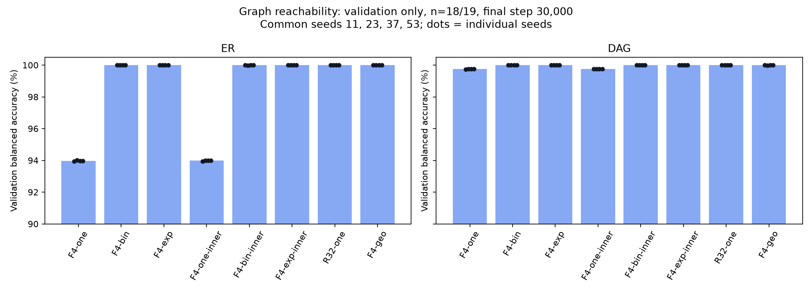

# Directed reachability: результаты на 12 октября 2026, 11:24 МСК

Срез сохранён **12 октября 2026 в 08:24:56 UTC / 11:24:56 МСК**.
Это обновление [предыдущего отчёта по Sudoku и графам](REPORT_SUDOKU_GRAPHS_RU.md),
где было завершено 33 из 80 графовых финалов. Теперь завершено **77/80**.
Все **48/48 пилотных и подтверждающих обучений** также завершены.
Рабочая GPU-очередь продолжает выполнение; публикация её не меняет.

**Тестовых результатов пока нет.** В этом протоколе сначала заканчиваются
все финальные обучения, затем фиксируются выбранные checkpoints и запускаются
test_ID, test_near, test_far, stress и проверки дополнительного вычисления.
Приведённые ниже числа — validation на графах с 18–19 вершинами после
30 000 обновлений, а не качество переноса на 32/64/128 вершин.

## Что завершено и что остаётся

| Этап | Готово | Содержание |
|---|---:|---|
| Выбор learning rate | 32/32 | 8 моделей × 2 семейства × 2 ставки, seed 101 |
| Подтверждение выбранной ставки | 16/16 | 8 моделей × 2 семейства, seed 103 |
| Финальное обучение | 77/80 | 30 000 обновлений на конфигурацию |
| Общие полные раунды seeds | 4/5 | 11, 23, 37, 53 завершены у всех моделей и семейств |
| Тестовые оценки | 0 | Этап ещё не начался |

Не завершены три конфигурации пятого раунда, seed 71:

- DAG / R32-one — обучение продолжается. Последний сохранённый `result.json`
  от предыдущего слота содержит 8696 шагов и статус `paused`; это штатная
  передача checkpoint между короткими выделениями, а не ошибка всей серии.
  Текущий процесс мог продвинуться дальше этого файла.
- ER / F4-geo — ожидает своей очереди.
- DAG / F4-geo — ожидает своей очереди.

Остальные 13 конфигураций пятого раунда завершены и включены в полный
per-seed CSV. Основное сравнение использует только **четыре общих seeds**,
чтобы разные строки таблицы имели одинаковое покрытие. Выбор этих seeds
определён порядком завершения всей сетки, а не значениями метрик.

## Данные и постановка

Модель получает ориентированный граф, вершину-источник s и вершину-цель t.
Ответ — существует ли ориентированный путь s → t. Метки задаёт directed BFS;
при подготовке направление независимо проверялось транзитивным замыканием.

Семейства ER и DAG обучаются и оцениваются отдельно. Сохраняются все вершины,
включая изолированные; крупнейшая компонента не выделяется. На случайный
граф приходится восемь равномерно выбранных различных запросов s ≠ t.
Классы искусственно не балансируются. Все запросы одного графа принадлежат
одному split.

| Split | Размеры n | Графов на семейство | Запросов на семейство |
|---|---|---:|---:|
| Train | 16, 17 | 100 000 | 800 000 |
| Validation | 18, 19 | 5 000 | 40 000 |
| Test ID | 16, 17 | 5 000 | 40 000 |
| Test near | 20–27 | 20 000 | 160 000 |
| Test far | 32, 64, 128 | 6 000 | 48 000 |

Всего сгенерированы 272 000 случайных графов и 2 176 000 запросов.
Отдельный stress-набор содержит 6000 шаблонов и 12 000 парных
positive/negative запросов с контролируемыми длинами путей.

Пять признаков вершины: константа, маркеры source и target,
`log(1 + indegree)` и `log(1 + outdegree)`. Ответ читается только из target.
При Bᵢⱼ = 1 для ребра i → j разрешённая маска внимания — I ∨ Bᵀ:
получатель собирает информацию от предшественников. Метки, длины путей,
идентификаторы компонент и скрытый порядок DAG не подаются в модель.

## Модели и обучение

F4 — четыре независимых блока внимания, width 128, четыре головы.
One-hop делает один перенос AV внутри блока. Биномиальный фильтр при r = 4:

\[
Y=\frac{4AV+6A^2V+4A^3V+A^4V}{15}.
\]

Экспоненциальный и геометрический фильтры используют те же четыре степени,
но другие положительные нормированные коэффициенты с согласованным средним
индексом переноса. Матрица A фиксирована внутри блока, но дифференцируема;
следующий блок вычисляет новое внимание. Максимальное число последовательных
переносов — 4 у F4-one и 16 у F4 с фильтром. Это предел передачи информации,
а не гарантия решения всех путей такой длины.

Варианты `inner` добавляют внутренний MLP с коэффициентом 0,1. Контроль
F4-one-inner тоже присутствует. R32-one повторяет один общий блок 32 раза,
пересчитывая внимание на каждом шаге; это отдельная рекуррентная архитектура.

Оптимизатор AdamW, batch 64, weight decay 0,01, clipping 1, warmup 1500 шагов,
cosine schedule до 30 000, float32, TF32 выключен. Loss — BCEWithLogits без
весов классов. Финалы стартуют с новой инициализацией. Одинаковый seed задаёт
одинаковый порядок выборки запросов и согласованные общие начальные тензоры.

Для каждого model/family ставка 0,0003 или 0,001 выбирается по полной
validation после 3000 шагов пилота seed 101: выше BA, затем ниже BCE,
затем меньшая ставка. Seed 103 подтверждает выбор. Пилоты сохраняют горизонт
scheduler 30 000 и не считаются финальными обучениями.

Validation финалов выполняется каждые 1000 шагов. Лучший checkpoint:
максимум BA, затем минимум BCE, затем самый ранний шаг. Таблица ниже
использует **последнюю validation на шаге 30 000**; будущие тесты используют
выбранный лучший checkpoint. Обе метрики и номер лучшего шага сохранены
в per-seed таблице.

## Полученные validation-результаты

BA = ½ × (recall положительного класса + specificity отрицательного класса).
Это точность бинарных запросов о достижимости, а не доля целиком решённых
графов. В каждой ячейке **mean ± sample SD, %**, по seeds 11, 23, 37, 53.
SD отражает различия обучений; это не доверительный интервал по графам.

| Модель | ER validation BA, % | DAG validation BA, % |
|---|---:|---:|
| F4-one | 93,9747 ± 0,0314 | 99,7573 ± 0,0124 |
| F4-bin | 99,9993 ± 0,0015 | 100,0000 ± 0,0000 |
| F4-exp | 99,9993 ± 0,0015 | 100,0000 ± 0,0000 |
| F4-one-inner | 93,9779 ± 0,0268 | 99,7636 ± 0,0000 |
| F4-bin-inner | 99,9963 ± 0,0073 | 100,0000 ± 0,0000 |
| F4-exp-inner | 99,9963 ± 0,0037 | 100,0000 ± 0,0000 |
| R32-one | 100,0000 ± 0,0000 | 100,0000 ± 0,0000 |
| F4-geo | 99,9993 ± 0,0015 | 99,9969 ± 0,0062 |

На ER биномиальная модель превосходит one-hop на **6,0246 п.п.** в среднем;
парные различия во всех четырёх seeds положительны: от +5,9774 до +6,0529 п.п.
На DAG разница значительно меньше: **+0,2427 п.п.**, от +0,2364 до +0,2613.
Это воспроизводимый разрыв на данной validation, но пока не оценка переноса
на большие n или длинные пути.

Преимущества именно биномиальных коэффициентов над exp/geo здесь не видно:
на ER средние BA у всех трёх совпадают до указанной точности, на DAG качество
почти предельное. Рекуррентная модель также достигает 100% на этой validation.
Нулевой SD означает одинаковые наблюдаемые scores четырёх обучений, а не
отсутствие неопределённости на будущих графах.

Inner MLP не устраняет разрыв one-hop на ER и не даёт прироста BA у сильных
фильтров на этой validation. У binomial средняя разница inner − без inner
составляет −0,00293 п.п. на ER и 0 на DAG. Такие очень малые различия около
потолка качества не позволяют утверждать общее преимущество или вред MLP.
Всё сравнение пока описательное; настройки по этим результатам не менялись.

## Вычислительная стоимость

Среднее накопленное время обновления весов, секунды, на тех же четырёх seeds:

| Модель | Параметров | ER, с | DAG, с |
|---|---:|---:|---:|
| F4-one | 792 193 | 326,1 | 324,1 |
| F4-bin | 792 193 | 381,6 | 376,7 |
| F4-exp | 792 193 | 388,8 | 374,5 |
| F4-one-inner | 925 313 | 394,5 | 386,9 |
| F4-bin-inner | 925 313 | 664,9 | 667,0 |
| F4-exp-inner | 925 313 | 683,4 | 666,2 |
| R32-one | 198 913 | 1546,3 | 1585,7 |
| F4-geo | 792 193 | 395,9 | 394,1 |

Validation, checkpoint I/O и ожидание очереди в столбцы выше не входят.
Полное время вызовов обучения сохранено отдельно как `elapsed_seconds`.
Сравнение задаёт одинаковые 30 000 обновлений, но не одинаковое время,
число параметров или количество операций. Отдельного equal-wall-time
эксперимента нет.

Учтено **61 904 секунды = 17,196 GPU-часа** завершённых выделений из потолка
24 GPU-часа. Активное выделение добавится после завершения. Этот счётчик
графовой очереди включает её preflight, profile, обучения и накладные расходы.
По записанным завершённым выделениям ошибок scheduler/exit code нет.
Остаток потолка до учёта активного слота — 6,804 GPU-часа; это не прогноз
времени до завершения, поскольку тестовые оценки ещё впереди.

Полный исходный план содержал 9 моделей, 54 пилота и 90 финалов.
До test по профилированию и резерву бюджета были допущены 8 моделей,
48 пилотов и 80 финалов. F4-learned остаётся вне допущенной сетки.
Завершение 80 финалов не будет означать выполнение всей первоначальной
девятимодельной сетки. Лимит ресурсов при этой публикации не повышался.

## Ревизия этого обновления

Отдельная CPU-проверка снимка завершилась успешно. Проверены:

- SHA-256 и размеры 645 скопированных файлов;
- 125 завершённых записей: 77 финалов, 32 LR-пилота, 16 подтверждений;
- 2598 validation-точек: confusion matrix, BA, accuracy, F1, числа классов,
  конечность скалярных метрик, частота validation и полная финальная выборка;
- соответствие config/hash, source/data hashes и числа выполненных обновлений;
- выбор learning rate из пилотов и выбор лучшего checkpoint по кривой;
- полное симметричное покрытие четырёх общих seeds и список незавершённых;
- совпадение 30 опубликованных файлов научного кода с исполняемой версией.

Новый inference и повторная проверка индивидуальных предсказаний не запускались:
тестовых предсказаний в этом срезе нет. BCE/AUROC сверялись как сохранённые
конечные метрики; без logits заново они не вычислялись. Пилотный выбор
проверен по полной финальной validation; промежуточные пилотные оценки
используют уменьшенную выборку и не подменяют финальную.

Существовавшие ранее 36 CPU-тестов, 18 GPU-smoke и overfit девяти архитектур
сохранены как исторические проверки подготовки, а не выданы за повторённые
при этой публикации. Первая попытка нового CPU-аудита не дошла до Python
из-за отсутствующего подключения окружения; после исправления отдельного
скрипта публикации повтор завершился успешно. Обучающий код и задания
этим исправлением не затронуты.

Исходный код: ветка [directed_reachability_v1](https://github.com/Kilkaintomat/binomial-attention-experiments/tree/directed_reachability_v1),
commit `2a10b8a8e56c7c04012ef8cdea3e164a9f9cf048`.
Научный source hash: `a98bc726b261c66a552a50b3fcf5e7dc165f7ba3fe12a52a722fe377ba9a8ed8`.
Data hash: `cf5ce937d591c8eea2e497f3bcef3bb111c2a7a9f5a2f6e5bfdaeb54921b0155`.

## Ограничения и следующий предусмотренный этап

Validation уже используется для выбора LR и checkpoint. Поэтому её scores
нельзя считать независимым test, даже если оценки близки к 100%.
Восемь запросов одного графа зависимы; 40 000 запросов не являются
40 000 независимыми графами. Интервалы по графам в этом отчёте не строятся.

Точные совпадения adjacency между split были исключены. Однако полный
изоморфный аудит обнаружил train-топологию у 3 из 5000 ER ID-test графов
и 610 из 5000 DAG ID-test графов (12,2%). ID-test нельзя описывать как
полностью новые топологии. Near/far отличаются числом вершин; их оценки
должны дать отдельную информацию о переносе. Данные после аудита не менялись.

Далее по уже запущенному плану: закончить три обучения, зафиксировать лучшие
checkpoints всех финалов и оценить ID/near/far/stress. Для bin/exp/geo
дополнительное вычисление проверяется при r = 4/8/16/32, для R32 — при
32/64/128 повторениях. Этот этап использует заранее выбранные подвыборки:
500 графов каждого far n и 50 шаблонов каждой stress-клетки. Full fixed-compute
test и extra-compute subset нельзя сравнивать без учёта состава выборки.
Результат этого этапа ещё не известен и в таблицах не подразумевается.

## Артефакты и воспроизведение

- [Все 77 финальных validation-результатов](results/reachability_update_20261012/tables/final_validation_per_seed.csv).
- [Основная сводка по четырём общим seeds](results/reachability_update_20261012/tables/validation_common_four_seeds.csv).
- [Все завершённые seeds, с явным числом на строку](results/reachability_update_20261012/tables/validation_all_completed.csv).
- [Парные описательные разности validation](results/reachability_update_20261012/tables/paired_validation_differences.csv).
- [Пилоты и подтверждения](results/reachability_update_20261012/tables/pilot_confirmation_validation.csv).
- [Не завершённые финалы](results/reachability_update_20261012/tables/unfinished_final_training.csv).
- [Аудит публикации](results/reachability_update_20261012/validation_audit.json),
  [снимок с хешами файлов](results/reachability_update_20261012/snapshot.json),
  [происхождение исходников](results/reachability_update_20261012/source_provenance.json).
- [Конфигурации, result JSON и кривые](results/reachability_update_20261012/reachability/records).

Таблицы и рисунок воспроизводятся в CPU allocation командой
`python scripts/build_reachability_update.py` из корня репозитория;
нужен Matplotlib. Необязательный `--source <checkout>` дополнительно
сверяет файлы опубликованной научной ветки. Эта команда не запускает обучение.

Каталог `runtime_report` внутри снимка — дословная архивная копия прежнего
серверного отчёта; он мог не обновляться во время обучения. Актуальные числа
этого обновления заново построены из `records` и находятся в `tables`
на верхнем уровне нового снимка. Пустые старые test-таблицы означают отсутствие
оценок, а не нулевое качество. Старые публикации и протоколы сохранены.
Датасеты, checkpoints, личные настройки сервера и исходные вложения
в обновление GitHub не включены.
