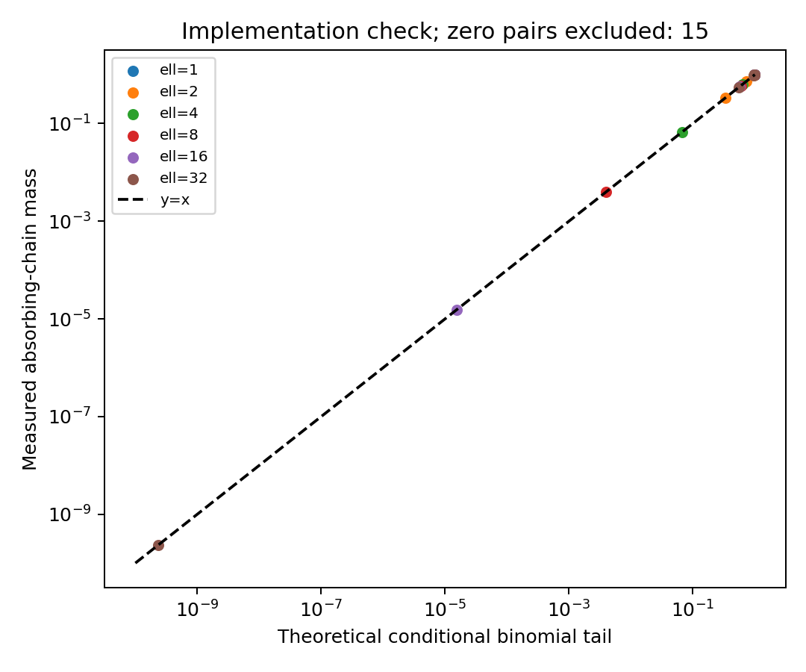

# Состояние экспериментов — 5 ноября 2026

Срез получен 05.11.2026 в 00:26:57 МСК. Прочитаны manifests, training/result JSON и журналы; существующие задания и checkpoints не изменялись.

| Серия | Завершено / запланировано | Состояние |
|---|---:|---|
| Смешанное обучение | 36 / 36 | Завершено |
| Раздельное обучение | 72 / 72 | Завершено |
| Sigmoid-гейты | 48 / 48 | Завершено |
| Gate=1, LoRA | 48 / 48 | Завершено |
| MLP и контроли | 14 / 36 | 1 checkpoint на 262/500, 21 запуск ещё не начат |

Всего завершены **218 обучений по 500 шагов**. После среза 4 ноября новых завершений нет. Подробные результаты каждого seed и дельты к baseline остаются в [отчёте от 4 ноября](REPORT_QWEN_RESULTS_20261104_RU.md); повторный сбор подтвердил те же числа завершений.

В очереди два двухчасовых задания MLP (8520925, 8520927), каждое запрашивает одну A100. Оба PENDING/`Priority`; время старта планировщик пока не указал. Зависимые задания контроля 8520926 и 8520928 ожидают их окончания. Статус `running` в сохранённом status.json означает активную кампанию и не подтверждает фактическое выполнение обучения.

Фактический расход по предыдущему учёту — около 91,20 GPU-часа; ещё 4 GPU-часа зарезервированы для ожидающих двухчасовых заданий. Это резерв, а не уже выполненные вычисления. Действующие пределы старой кампании: общий 200 GPU-часов, новые серии 65, MLP 20. Лимит сейчас не является причиной ожидания: Slurm сообщает `Priority`.

## Новая языковая кампания: подготовлена и активирована

[Полный протокол с математикой, данными и аудитом](research/language_transport_20261105/PROTOCOL_RU.md) · [Код](research/language_transport_20261105/code) · [Команды воспроизведения](research/language_transport_20261105/REPRODUCE_RU.md) · [Manifests и подтверждения](results/language_transport_20261105).

Проверка очереди после активации — **05.11.2026, 00:50:51 МСК**. Диспетчер 8521804 завершил первый проход, следующее CPU-задание **8521805** стоит в очереди с `BeginTime`. Статус новой кампании — **waiting_existing_mlp**, старый MLP завершён на 14/36. Контроллер проверяет условие каждые 30 минут. В новой серии пока **не отправлены GPU allocations**, GPU-расход равен нулю. Это активированная последовательность запуска; основные обучения ещё не начались.

| Подготовленные основные условия | Число обучений/оценок |
|---|---:|
| Scratch: VT, conditional p-hop, canonical p=16 и p=32 × ordinary/binomial/geometric/looped × 3 seed | 48 обучений |
| Qwen3-1.7B: VT и conditional p-hop × ordinary LoRA/binomial 2 слоя/binomial 4 слоя × 3 seed | 18 обучений |
| Qwen3-1.7B без task fine-tuning на двух задачах | 2 оценки |
| Отдельные pilot: VT по двум LR и conditional p-hop | 6 обучений |

Основные seed — **11, 22, 33**. У биномиального и геометрического вариантов r_train=8; дополнительные r=1/2/4/8/16/32/64/80/96 проверяются на тех же весах. Recurrent пересчитывает QKV и FFN, разделяя веса полного backbone; для него запланированы дополнительные loops=1/2/4/8/16. Внутреннего MLP и обучаемого gate в этой кампании нет.

Следующий GPU-результат после освобождения старой кампании — численный preflight, tiny overfit и измеренная скорость. Затем идут pilot и основные scratch-сравнения. Дообучение Qwen зависит от прохождения проверки обучаемости ordinary baseline на короткой validation. Глубокий test не используется для выбора LR, числа шагов или слоёв. Оценка общей длительности ещё не измерена; она будет записана по фактическому benchmark, без обещания времени старта Slurm.

В отдельном разрешении зафиксированы **240 GPU-часов для новой кампании и 500 GPU-часов общего предела учёта**, не более двух новых workers по одной A100, задания по два часа. По явному разрешению пользователя новая граница может увеличиваться на основании измеренной оценки затрат. Старые authorization/ledgers сохранены. Проверки до GPU-пилота не списали GPU-часы.

## Что уже проверено и получено

Финальное CPU-задание **8521800** успешно выполнило **19 тестов**: эталон фильтра до r=96; gradcheck; причинность; padding; RoPE/GQA; P1 против native attention; shared recurrent weights с фактическим пересчётом; независимые решатели; answer-only loss; pause/resume; повторная оценка без дубликатов; защита старых заданий и budget accounting.

Созданы четыре train-пула по 16384 примера. Раздельные validation/pilot/tiny/test имеют независимые seeds; проверены отсутствие точных дубликатов и покрытие входного словаря scratch. Токенизатор Qwen проверен на срезах обеих задач. Его checkpoint уже имелся локально на сервере; дополнительные модельные данные не скачивались. Библиотеки построения графиков скачаны в отдельную папку новой кампании, общий environment обучения не обновлялся.

Один промежуточный CPU-запуск 8521798 завершился ошибкой импорта только что установленных plotting-зависимостей: процесс сохранял отрицательный кэш импортов. Исправление внесено до фиксации протокола; финальная проверка 8521800 прошла. Эта ошибка не затрагивала GPU или существующее обучение. История попыток сохранена в [launch receipt](results/language_transport_20261105/launch_receipt.json).

На **54 аналитических случаях** известной поглощающей цепочки измеренная масса совпала с биномиальным хвостом с максимальной абсолютной ошибкой **1,11×10⁻¹⁶**. Это проверка реализации, не accuracy обученной LM. На log-log графике отдельно указаны 15 нулевых пар.

| Подготовленный test | Размер | Самопетли | Нетривиальные маршруты на все p переходов | BOTTOM |
|---|---:|---:|---:|---:|
| VT, адаптация | 1024 | — | — | — |
| Условный p-hop, объединённый инвентарный счёт iid + no_adjacent | 1024 | 118 | 906 | 0 |
| Канонический p=16 | 512 | 124 | 388 | 0 |
| Канонический p=32 | 512 | 113 | 399 | 0 |

Это **статистика генератора**, а не качество моделей. Метрики conditional iid/no_adjacent будут рассчитаны раздельно. В данной выборке BOTTOM не встретился; для этого среза нельзя будет заявлять измеренную accuracy. Ручные тесты solver включают отсутствующую ссылку и самопетлю.

Source SHA-256 новой кампании: `7f143b2d01d8d1cfee3161d4349213af4c443e64b3661ccfc5ee7c2dc80e51e0`. Manifest SHA-256: `9e3211911eed089cfa9e557bfffb471cae2ec2ec856f5e99fe693e20a07733d6`. Локальная и серверная версии совпали. Все 218 прежних result.json также совпали с предыдущим опубликованным срезом; изменённых результатов нет.

## Численный режим диагностики

В scratch-evaluation используются FP32 weights и вычисления; Qwen работает в BF16. Операторная масса диагностируется в FP32 по сохранённым матрицам внимания модели. Это отдельная численная характеристика; она не подменяет фактическую генерацию или вероятность ответа. Аналитический oracle проверяется в FP64. GPU-preflight и измерение скорости ещё ожидаются.

## Источники постановок

[RULER и официальный генератор](https://github.com/NVIDIA/RULER), [Saunshi et al., Definition A.1](https://arxiv.org/html/2502.17416v1), [Sanford et al.](https://proceedings.mlr.press/v235/sanford24a.html). Наш VT запрашивает значение конечной переменной, тогда как официальный RULER VT перечисляет переменные с указанным значением. Канонический p-hop и условная адаптация явно разделены в протоколе и коде.

