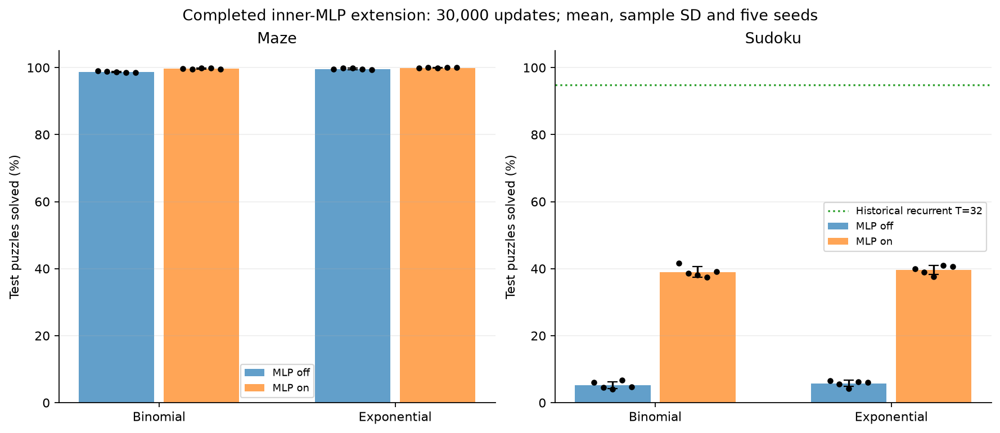
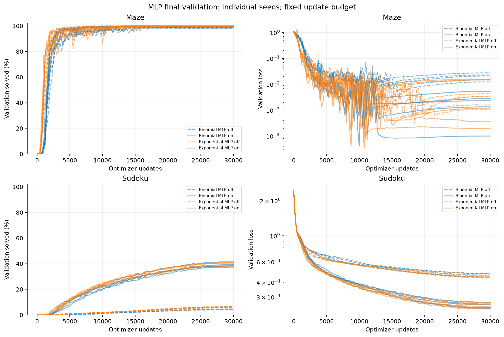
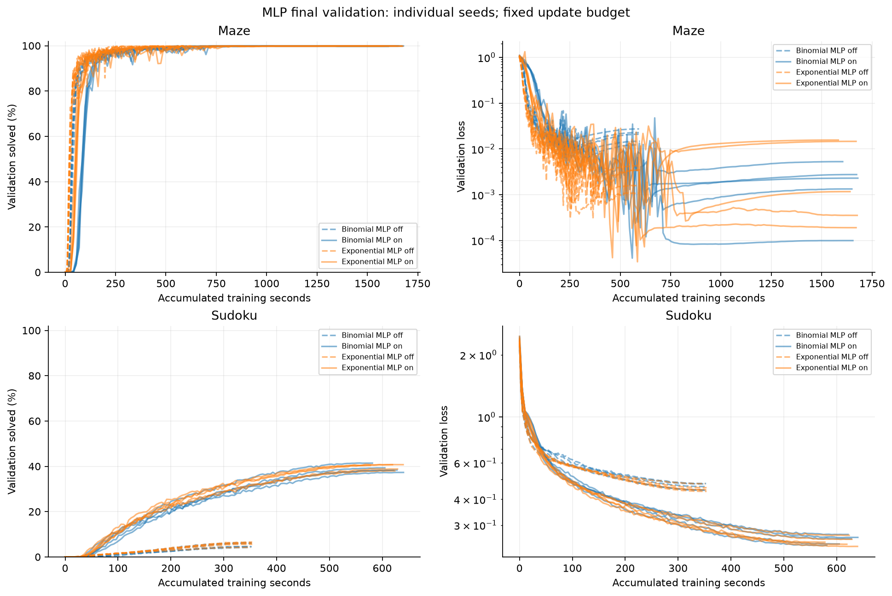

# Финальная серия с внутренним MLP

Срез: **2026-10-11T08:49:15.331206+00:00**. Завершены **20/20** новых обучений по **30 000 optimizer updates**. Ни один seed не исключён. Это финальные test-результаты; короткие 500-step пилоты сюда не входят.

Внутренний MLP увеличил средний Sudoku solved до 38.98% у binomial и 39.66% у exponential; без него было около 5–6%. На Maze оба варианта решают более 99,7% задач в среднем.

| Задача | Фильтр | Без MLP, % | С MLP, % | Δ, п.п. | 95% CI Δ, п.п. |
| --- | --- | --- | --- | --- | --- |
| maze | Binomial | 98.7600 ± 0.1817 | 99.7200 ± 0.1789 | +0.9600 | [+0.7400; +1.1800] |
| maze | Exponential | 99.5800 ± 0.2168 | 99.9400 ± 0.0894 | +0.3600 | [+0.1800; +0.5600] |
| sudoku | Binomial | 5.2278 ± 1.0799 | 38.9789 ± 1.5801 | +33.7511 | [+32.1644; +34.9556] |
| sudoku | Exponential | 5.7622 ± 0.9416 | 39.6578 ± 1.3395 | +33.8956 | [+33.3889; +34.4022] |

В таблице mean ± sample SD по пяти обучающим seeds: 11, 23, 37, 53, 71. Δ — парная разность MLP on − off на одинаковом seed. Test: 1000 лабиринтов или 18000 Sudoku. Единица независимого повторения — обучение, а не отдельная задача.



## Все seeds с MLP

| Задача | Фильтр | 11 | 23 | 37 | 53 | 71 |
| --- | --- | --- | --- | --- | --- | --- |
| maze | Binomial | 99.7000 | 99.6000 | 99.9000 | 99.9000 | 99.5000 |
| maze | Exponential | 99.8000 | 100.0000 | 99.9000 | 100.0000 | 100.0000 |
| sudoku | Binomial | 41.5778 | 38.6944 | 38.0833 | 37.4500 | 39.0889 |
| sudoku | Exponential | 40.0056 | 38.9833 | 37.6778 | 40.9111 | 40.7111 |

Полные исходные значения, CE, exact match, blank accuracy/vertex F1, best step, время и память: [CSV по seeds](results/tables/mlp_final_per_seed.csv). В нём 40 строк: 20 новых результатов и 20 соответствующих исторических контролей.

## Постановка и реализация

Парная абляция четырёх независимых внешних Transformer-блоков: меняется inner_beta с 0 на 0,1, inner_width=128. В каждом блоке матрица attention вычисляется один раз; между переносами добавляется общий для шагов этого блока MLP с GELU и LayerNorm, смешивающий головы. Следующий внешний блок пересчитывает attention. Внешний FFN сохранён. Это отдельная серия от новых рекуррентных фильтров и локальных Sudoku-масок.

Maze: 8×8, 10000/1000/1000, H=16; Sudoku: официальный Sudoku-Hard, 180000/18000/18000, H=4 и стандартная маска строки/столбца/квадрата. Общие данные, именованная инициализация общих весов, поток minibatch с возвращением, batch 64, AdamW, warmup/cosine и 30000 updates сохранены. LR Maze/binomial=0,0003; остальные включённые конфигурации=0,001. Изначальная сетка и соответствие пар зафиксированы [до обучения](results/protocols/mlp_final_protocol.json).

Validation выполнялась на шаге 1 и каждые 250 обновлений. Test посчитан у checkpoint с максимальным validation solved, затем минимальным validation loss и самым ранним шагом при точном равенстве. Заданные цифры Sudoku копируются; остальные — argmax, без solver/repair. Проверка решений использует полные правила Sudoku.

MLP добавляет 133120 параметров: Maze 792577→925697, Sudoku 797449→930569. Число FFN-вызовов на forward возрастает с 4 до 68 на Maze и до 20 на Sudoku. Поэтому результат не изолирует эффект нелинейности от дополнительных параметров и вычислений.

## Неопределённость и сравнение фильтров

| Задача | Сравнение | Среднее, п.п. | Sample SD, п.п. | 95% CI, п.п. |
| --- | --- | --- | --- | --- |
| maze | binomial_MLP_minus_no_MLP | +0.9600 | 0.2793 | [+0.7400; +1.1800] |
| maze | exponential_truncated_MLP_minus_no_MLP | +0.3600 | 0.2408 | [+0.1800; +0.5600] |
| maze | binomial_minus_exponential_MLP | -0.2200 | 0.2168 | [-0.4000; -0.0600] |
| sudoku | binomial_MLP_minus_no_MLP | +33.7511 | 1.7611 | [+32.1644; +34.9556] |
| sudoku | exponential_truncated_MLP_minus_no_MLP | +33.8956 | 0.6777 | [+33.3889; +34.4022] |
| sudoku | binomial_minus_exponential_MLP | -0.6789 | 1.9382 | [-2.3200; +0.7333] |

Описательный анализ после завершения обучения: percentile bootstrap по пяти парным seeds, 20000 повторов, RNG seed 20261011. Интервалы не скорректированы за множественные сравнения и не являются новым заранее зарегистрированным подтверждающим тестом. Пять seeds ограничивают точность; интервал, включающий ноль, не доказывает эквивалентность.

Добавление MLP помогает обоим фильтрам, но отдельного преимущества биномиального фильтра эти результаты не устанавливают. На Maze различается также LR. На Sudoku 39–40% остаются существенно ниже исторических 94,77% у recurrent T=32; это сравнение архитектур с разной глубиной, параметрами и вычислительной стоимостью.

## Время, память и бюджет

| Задача | Фильтр | Train без MLP, с | Train с MLP, с | Среднее парное on/off | Elapsed с MLP, с | Forward с MLP, мкс/задачу при batch 64 | Peak train с MLP, MiB mean |
| --- | --- | --- | --- | --- | --- | --- | --- |
| maze | Binomial | 593.50 | 1652.33 | 2.784 | 1704.60 | 254.00 | 834.3 |
| maze | Exponential | 593.98 | 1648.22 | 2.775 | 1700.68 | 253.98 | 834.3 |
| sudoku | Binomial | 351.81 | 615.21 | 1.749 | 1035.88 | 87.53 | 450.1 |
| sudoku | Exponential | 352.89 | 617.86 | 1.751 | 1042.58 | 87.84 | 448.7 |

Фактические выделения для MLP-расширения: **27682 с = 7.6894 GPU-часа**, включая неудачную попытку сохранения и служебные расходы. Вся прежняя кампания: **80671 с = 22.4086 GPU-часа из 24**. Новые рекуррентная и локальная серии сюда не включены.

Training seconds включают batch, forward/backward и optimizer. Elapsed добавляет validation/checkpoint внутри обучающих вызовов; это не время календарного ожидания в очереди. Полные GPU-выделения учитываются отдельно. Forward timing исключает подготовку признаков, decode и validator; batch time/64 не является задержкой одиночного запроса. Приведены сохранённые измерения исходных обучений, без нового speed benchmark и без equal-wall-time retraining.





Пороги: Maze90%; Sudoku50%/90%, подтверждение двумя последовательными validation. Все достигнутые и недостигнутые исходы сохранены в [таблице порогов](results/tables/mlp_final_thresholds.csv); времена не усредняются только по успешным seeds. Для достигнутых новых порогов проверены веса до/после первого прохождения, для старых контролей используются кривые.

## Выполненный аудит и границы вывода

В отдельном CPU allocation проверены все 20 новых final configs, source/data hashes,121 validation-точка на каждый run, выбор best, полные 30000 шагов, конечный optimizer/scheduler и RNG. Совпадение общих начальных весов и потока обучающих batches с парным контролем проверено для каждого seed. Независимо перепроверены все **190000 сохранённых test-предсказаний**; ответы лучших checkpoint повторены на **320 примерах** — по 16 на run. Ошибок в этих проверках не найдено. Полный test-forward повторно не выполнялся.

Machine-readable evidence: [новый аудит](results/audit/mlp_final_publication_audit.json). Прежний аудит 570000 предсказаний относится к основной серии и не переименован в аудит MLP. Архивные протоколы и результаты контролей сохранены. В публикации отсутствуют веса, массивы предсказаний, исходные datasets, внешние документы и приватные настройки.

Официальный test уже известен из прежней работы. Это последующее исследование известного benchmark. Не выполнены outer-only parameter-matched контроль, финальный общий-LR контроль между Maze-фильтрами и отдельные обучения при одинаковом wall time. Нельзя приписать весь прирост исключительно чередованию переноса и нелинейности либо объявить все варианты эквивалентными.

## Воспроизведение отчёта

В CPU allocation из корня публичной копии:

```bash
python scripts/build_mlp_final_assets.py
python scripts/check_mlp_final_snapshot.py
```

Для независимого повторения проверки private checkpoints нужны отдельно сохранённые артефакты и команда `scripts/audit_mlp_final_publication.py --artifact-root <artifact_root>`; CSV не заменяет эти веса. Новое обучение для построения таблиц не требуется.

[Основной отчёт](REPORT_RU.md) · [Агрегаты](results/tables/mlp_final_aggregates.csv) · [Парные разности](results/tables/mlp_final_pairs.csv) · [Интервалы](results/tables/mlp_final_contrasts.csv)
