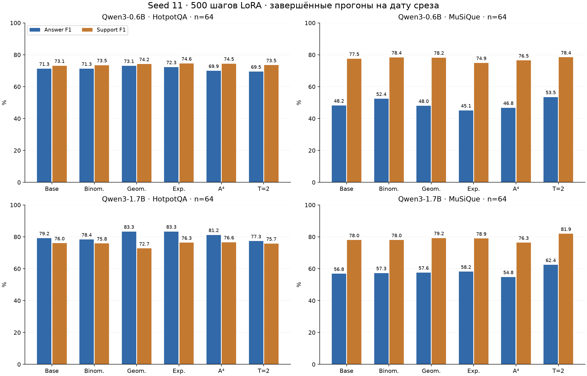
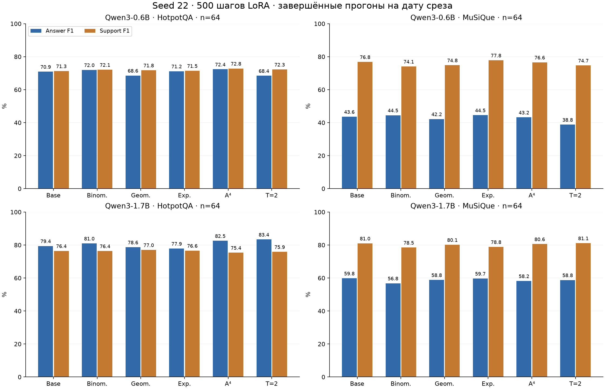
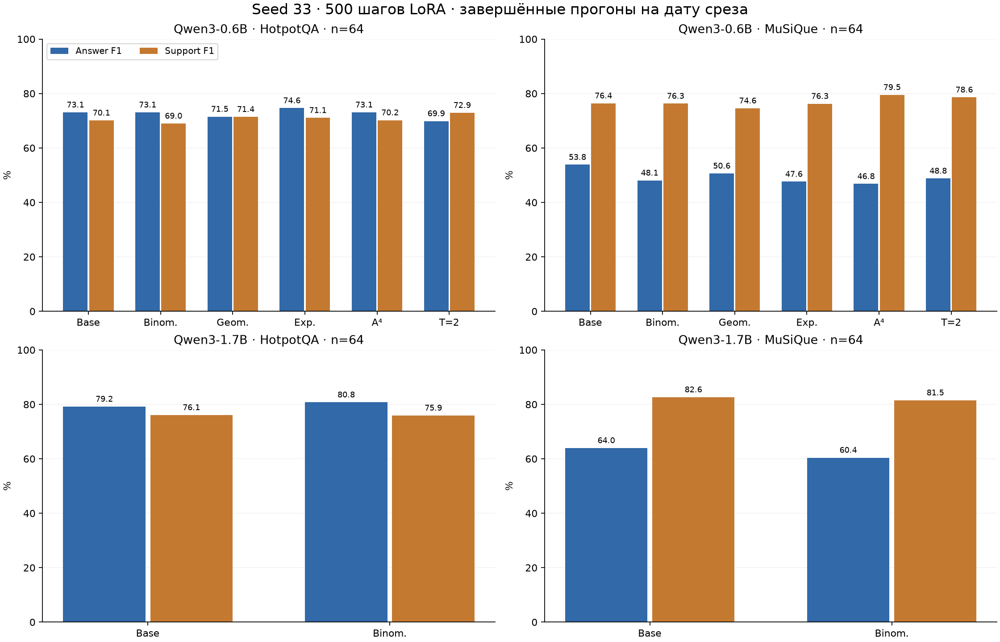
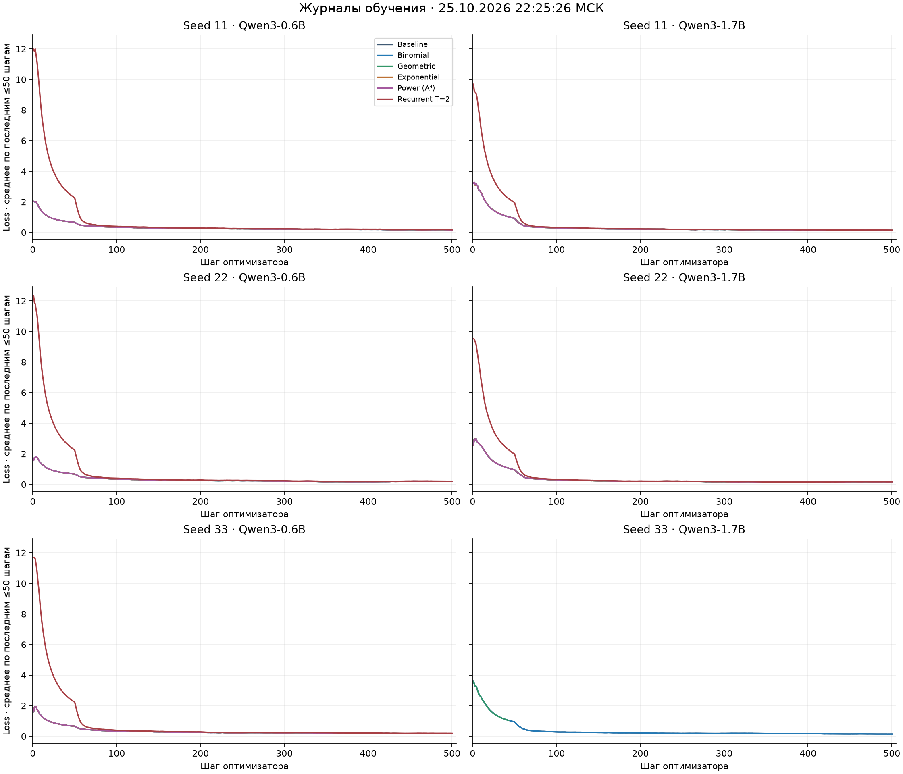

# Qwen3: эксперимент с полиномиальным attention и повторением блоков — результаты по seed

Срез результатов: **25.10.2026 22:25:26 МСК**. Серия: `qbm_multiseed_20261024`.

В серии запланировано 36 прогонов: две модели, шесть вариантов и три seed. Каждый прогон включает 500 обновлений LoRA и оценку на 64 внутренних примерах HotpotQA и 64 внутренних примерах MuSiQue. На дату среза число прогонов с завершёнными обучением и оценкой — **32**; начаты, но не завершены — 1; ещё не начаты — 3.

Обновление предыдущего отчёта от 25.10.2026 13:41:53 МСК: сохранены результаты всех 14 завершённых прогонов из того среза и добавлены 18 новых завершённых прогонов. Прежние метрики и записи шагов обучения сверены с предыдущими файлами без расхождений. [Предыдущий отчёт](archive/20261025_134153/REPORT_QWEN_MULTISEED_20261025_RU.md).

Все показатели ниже относятся к этим внутренним выборкам, выделенным из официальных обучающих данных. Официальные dev/test в данной серии не использовались. Результаты более ранних 100-шаговых прогонов и экспериментов без обучения в таблицы не включены.

## 1. Постановка эксперимента

Модель получает вопрос и полный набор документов из примера. Требуется сгенерировать короткий ответ и ссылки на подтверждающие факты. Для HotpotQA ссылки имеют вид `D<i>:S<j>` и указывают на предложение документа; для MuSiQue — `D<i>` и указывают на абзац. Вход содержит исходные документы и отвлекающие документы. Поддерживающие факты используются как целевая разметка ответа, а не для выбора входных документов.

Сравниваются Qwen3-0.6B и Qwen3-1.7B. В каждой модели 28 исходных decoder-блоков. Полиномиальные изменения и повторения применяются к последним четырём блокам с индексами **24, 25, 26, 27**, нумерация с нуля. LoRA подключается к Q/K/V/O-проекциям всех 28 исходных блоков.

| Модель | Ревизия исходного checkpoint |
| --- | --- |
| Qwen/Qwen3-0.6B | `c1899de289a04d12100db370d81485cdf75e47ca` |
| Qwen/Qwen3-1.7B | `70d244cc86ccca08cf5af4e1e306ecf908b1ad5e` |

### 1.1. Варианты attention

Пусть $A$ — причинная матрица attention одной головы, а $V$ — её значения. Полиномиальная ветвь вычисляет $P(A)V=\sum_{s=1}^{4}c_s A^sV$. В модифицированных блоках используется смесь $Y=(1-g_\ell)AV+g_\ell P(A)V$, затем штатная выходная проекция. Для каждого из четырёх блоков обучается один скаляр $g_\ell$, общий для голов этого блока. Начальное значение всех четырёх gates равно нулю; после обновления они проецируются на $[0,1]$. Коэффициенты $c_s$ фиксированы.

| Вариант | Вычисление |
| --- | --- |
| Baseline | Штатный Qwen3 attention через SDPA. |
| Binomial | $P(A)=(4A+6A^2+4A^3+A^4)/15$. |
| Geometric | Конечное распределение $c_s\propto q^{s-1}$, $s=1,2,3,4$. |
| Exponential | Усечённое распределение $c_s\propto\lambda^s/s!$, $s=1,2,3,4$. |
| Power (A⁴) | Полиномиальная ветвь $P(A)V=A^4V$, смешиваемая с $AV$ через gate. |
| Recurrent T=2 | Каждый из блоков 24–27 применяется дважды с общими весами и LoRA; 32 применения блоков за проход. |

Для Geometric и Exponential параметр распределения выбран так, чтобы $\sum_s s c_s=32/15$, как у Binomial. Веса ветвей:

| Вариант | c₁ | c₂ | c₃ | c₄ | Σ s·cₛ |
| --- | --- | --- | --- | --- | --- |
| Binomial | 0.26666667 | 0.40000000 | 0.26666667 | 0.06666667 | 2.13333333 |
| Geometric | 0.37122320 | 0.27479278 | 0.20341150 | 0.15057252 | 2.13333333 |
| Exponential | 0.32506296 | 0.33242260 | 0.22663259 | 0.11588185 | 2.13333333 |
| Power (A⁴) | 0.00000000 | 0.00000000 | 0.00000000 | 1.00000000 | 4.00000000 |

В полиномиальной ветви одна матрица $A$ последовательно применяется к значениям внутри текущего блока; градиенты через $A$ сохраняются. GQA, QK-normalization, RoPE и FFN остаются частью блока. Для генерации сохраняются KV-кэш и промежуточные транспортные состояния $AV$, $A^2V$, $A^3V$. В Recurrent T=2 повторяется целый блок, включая attention и FFN; каждому повтору выделен отдельный слот кэша. T=4 не входит в зафиксированные 36 прогонов этой серии.

## 2. Данные и разбиение

Использованы HotpotQA, конфигурация distractor, и MuSiQue-Ans v1.0. Разбиение формируется один раз с seed **20261022**: примеры сортируются по ID, перемешиваются, первые 1000 образуют внутренний резерв для оценки. Из оставшихся данных удаляются вопросы, совпадающие с внутренним резервом после приведения к нижнему регистру и удаления крайних пробелов. Для MuSiQue также удаляются примеры с общими single-hop component IDs с внутренним резервом.

| Датасет | Официальный train | Внутренний резерв | Удалено из оставшегося train | Осталось в train | Пул обучения | Выборка оценки |
| --- | --- | --- | --- | --- | --- | --- |
| HotpotQA | 90447 | 1000 | 0 | 89447 | 2000 | 64 |
| MuSiQue | 19938 | 1000 | 10997 | 7941 | 2000 | 64 |

Из подготовленных списков берутся первые 2000 подходящих обучающих и первые 64 оценочных примера каждого датасета. Предельная длина входа — 8192 токена: слишком длинный пример исключается целиком. Усечение документов не применяется. При заполнении этих четырёх выборок число исключений по длине равно нулю.

| Датасет | Максимум входных токенов, train | Максимум входных токенов, оценка | Среднее входных токенов, оценка | Распределение hop в оценке |
| --- | --- | --- | --- | --- |
| HotpotQA | 4272 | 3604 | 1714.297 | 2-hop: 64 |
| MuSiQue | 4991 | 5317 | 2673.312 | 2-hop: 45; 3-hop: 15; 4-hop: 4 |

Одинаковые оценочные примеры и их порядок используются для всех моделей, методов и seed. Токенизация оценочных входов у двух моделей совпадает. Версии данных, контрольные суммы выборок и ревизии моделей записаны в [protocol.json](results/qwen_multiseed_20261025/protocol.json).

## 3. Обучение

| Параметр | Значение |
| --- | --- |
| Seed обучения | 11, 22, 33 |
| Начальное состояние | Исходный checkpoint модели и заново инициализированная LoRA для каждого прогона |
| Число обновлений | 500 |
| Microbatch / accumulation / effective batch | 1 / 8 / 8 |
| Состав одного обновления | 4 примера HotpotQA и 4 примера MuSiQue, выборка с возвращением |
| Обращения к обучающим примерам за прогон | 4000, по 2000 из каждого пула |
| LoRA rank / alpha / dropout | 16 / 32 / 0 |
| Проекции | q_proj, k_proj, v_proj, o_proj во всех исходных блоках |
| Оптимизатор | AdamW; стандартные betas=(0.9, 0.999), eps=1e-8 |
| Weight decay | 0.01 для LoRA; 0 для gates |
| Пиковый LR LoRA | 0.0001 |
| LR gates | 100 × текущий LR LoRA |
| Разогрев | 10 обновлений |
| Дальнейший LR | Косинусное снижение к 10% пикового LR |
| Gradient clipping | Глобальная норма 1.0 |
| Точность исходной модели | BF16; TF32 отключён |
| Gradient checkpointing | Включён при обучении, use_reentrant=False |
| Целевая часть loss | Токены ответа, ссылок на факты и EOS |
| Выбор checkpoint | Последнее фиксированное обновление, шаг 500 |

Базовые веса заморожены. Для Baseline и Recurrent T=2 обучаются только LoRA-параметры; для четырёх полиномиальных вариантов дополнительно обучаются четыре gates. Количество уникальных обучаемых параметров:

| Модель | Baseline / Recurrent T=2 | Binomial / Geometric / Exponential / Power |
| --- | --- | --- |
| 0.6B | 4 587 520 | 4 587 524 |
| 1.7B | 6 422 528 | 6 422 532 |

Seed задаёт состояние Python, NumPy, PyTorch и CUDA, инициализацию LoRA и отдельного генератора выбора обучающих примеров. При одинаковом seed порядок выборки примеров одинаков для всех методов и размеров модели. При возобновлении сохраняются LoRA, gates, состояние оптимизатора, номер шага, состояния sampler, PyTorch и CUDA RNG.

Обучающая цель имеет вид `Answer: <answer>`, затем новая строка и `Evidence: <citations>`. Для обучения берётся первый вариант ответа из разметки. Cross-entropy считается только на этой целевой части и EOS; токены вопроса и документов не входят в loss. Записанный loss шага — среднее восьми microbatch-loss. Для оценки ответа используются все доступные варианты и aliases.

## 4. Генерация и метрики

При оценке используется non-thinking chat template (`enable_thinking=False`), batch=1, greedy argmax, `do_sample=False`, DynamicCache и лимит 128 новых токенов. Генерация завершается на EOS либо на лимите. Модель получает инструкцию вернуть две строки: `Answer:` и `Evidence:`. Оценка каждого прогона выполняется после его 500-го обновления.

| Показатель | Определение |
| --- | --- |
| Answer EM | Средняя доля точных совпадений нормализованного ответа с одним из допустимых ответов. |
| Answer F1 | Средний token F1 ответа; для нескольких допустимых ответов берётся максимальное значение для примера. |
| Support EM | Средняя доля точных совпадений множества ссылок на подтверждающие факты. |
| Support F1 | Средний F1 множества подтверждающих фактов: предложения для HotpotQA, абзацы для MuSiQue. |
| Format | Доля outputs, в которых парсер нашёл строки с заголовками Answer: и Evidence:. |
| Время генерации | Prefill и последовательное декодирование; CUDA синхронизируется на границах замера. |
| Пик GPU | Максимум torch.cuda.max_memory_allocated по примерам; счётчик сбрасывается перед каждым примером. |

Метрики вычисляются через сохранённые upstream scorers HotpotQA и MuSiQue. Значения EM, F1 и Format в таблицах приведены в процентах (0–100); в JSON/CSV они хранятся в шкале 0–1. Каждый показатель усредняется по примерам своего датасета. Время и память записаны во время оценки внутри процесса обучения, где состояние оптимизатора ещё присутствует; это соответствует фактическим условиям этих замеров.

## 5. Состояние прогонов по seed

| Модель | Вариант | Seed 11 | Seed 22 | Seed 33 |
| --- | --- | --- | --- | --- |
| 0.6B | Baseline | 500/500; оценка 128/128 | 500/500; оценка 128/128 | 500/500; оценка 128/128 |
| 0.6B | Binomial | 500/500; оценка 128/128 | 500/500; оценка 128/128 | 500/500; оценка 128/128 |
| 0.6B | Geometric | 500/500; оценка 128/128 | 500/500; оценка 128/128 | 500/500; оценка 128/128 |
| 0.6B | Exponential | 500/500; оценка 128/128 | 500/500; оценка 128/128 | 500/500; оценка 128/128 |
| 0.6B | Power (A⁴) | 500/500; оценка 128/128 | 500/500; оценка 128/128 | 500/500; оценка 128/128 |
| 0.6B | Recurrent T=2 | 500/500; оценка 128/128 | 500/500; оценка 128/128 | 500/500; оценка 128/128 |
| 1.7B | Baseline | 500/500; оценка 128/128 | 500/500; оценка 128/128 | 500/500; оценка 128/128 |
| 1.7B | Binomial | 500/500; оценка 128/128 | 500/500; оценка 128/128 | 500/500; оценка 128/128 |
| 1.7B | Geometric | 500/500; оценка 128/128 | 500/500; оценка 128/128 | 43/500; оценка не начата |
| 1.7B | Exponential | 500/500; оценка 128/128 | 500/500; оценка 128/128 | Не начат |
| 1.7B | Power (A⁴) | 500/500; оценка 128/128 | 500/500; оценка 128/128 | Не начат |
| 1.7B | Recurrent T=2 | 500/500; оценка 128/128 | 500/500; оценка 128/128 | Не начат |

На дату среза выполняется прогон seed=33 / 1.7B / Geometric; последний зарегистрированный шаг — 43/500. Для незавершённых прогонов итоговые оценочные метрики не заполнены.

## 6. Результаты seed=11

Завершено 12 из 12 прогонов: для 0.6B — 6 из 6, для 1.7B — 6 из 6. В каждом завершённом прогоне выполнено 500 обновлений и оценено 128 примеров; число записанных предсказаний — 1536.

### Qwen3-0.6B · HotpotQA · 64 примера

| Вариант | Answer EM, % | Answer F1, % | Support EM, % | Support F1, % | Format, % |
| --- | --- | --- | --- | --- | --- |
| Baseline | 65.62 | 71.30 | 35.94 | 73.12 | 100.00 |
| Binomial | 65.62 | 71.30 | 34.38 | 73.48 | 100.00 |
| Geometric | 67.19 | 73.07 | 35.94 | 74.17 | 100.00 |
| Exponential | 65.62 | 72.29 | 37.50 | 74.56 | 100.00 |
| Power (A⁴) | 62.50 | 69.95 | 37.50 | 74.46 | 100.00 |
| Recurrent T=2 | 59.38 | 69.46 | 37.50 | 73.51 | 100.00 |

### Qwen3-0.6B · MuSiQue · 64 примера

| Вариант | Answer EM, % | Answer F1, % | Support EM, % | Support F1, % | Format, % |
| --- | --- | --- | --- | --- | --- |
| Baseline | 39.06 | 48.19 | 51.56 | 77.51 | 100.00 |
| Binomial | 43.75 | 52.43 | 50.00 | 78.37 | 100.00 |
| Geometric | 39.06 | 48.01 | 51.56 | 78.24 | 100.00 |
| Exponential | 35.94 | 45.13 | 50.00 | 74.90 | 100.00 |
| Power (A⁴) | 37.50 | 46.78 | 50.00 | 76.47 | 100.00 |
| Recurrent T=2 | 42.19 | 53.50 | 50.00 | 78.42 | 100.00 |

### Qwen3-1.7B · HotpotQA · 64 примера

| Вариант | Answer EM, % | Answer F1, % | Support EM, % | Support F1, % | Format, % |
| --- | --- | --- | --- | --- | --- |
| Baseline | 70.31 | 79.18 | 39.06 | 76.01 | 100.00 |
| Binomial | 70.31 | 78.37 | 40.62 | 75.84 | 100.00 |
| Geometric | 75.00 | 83.30 | 40.62 | 72.72 | 100.00 |
| Exponential | 75.00 | 83.35 | 42.19 | 76.35 | 100.00 |
| Power (A⁴) | 75.00 | 81.22 | 42.19 | 76.61 | 100.00 |
| Recurrent T=2 | 68.75 | 77.31 | 45.31 | 75.74 | 100.00 |

### Qwen3-1.7B · MuSiQue · 64 примера

| Вариант | Answer EM, % | Answer F1, % | Support EM, % | Support F1, % | Format, % |
| --- | --- | --- | --- | --- | --- |
| Baseline | 48.44 | 56.82 | 50.00 | 77.98 | 100.00 |
| Binomial | 51.56 | 57.28 | 51.56 | 77.99 | 100.00 |
| Geometric | 51.56 | 57.59 | 54.69 | 79.23 | 100.00 |
| Exponential | 53.12 | 58.18 | 54.69 | 78.94 | 100.00 |
| Power (A⁴) | 48.44 | 54.79 | 50.00 | 76.35 | 100.00 |
| Recurrent T=2 | 54.69 | 62.41 | 51.56 | 81.93 | 100.00 |

## 7. Результаты seed=22

Завершено 12 из 12 прогонов: для 0.6B — 6 из 6, для 1.7B — 6 из 6. В каждом завершённом прогоне выполнено 500 обновлений и оценено 128 примеров; число записанных предсказаний — 1536.

### Qwen3-0.6B · HotpotQA · 64 примера

| Вариант | Answer EM, % | Answer F1, % | Support EM, % | Support F1, % | Format, % |
| --- | --- | --- | --- | --- | --- |
| Baseline | 62.50 | 70.92 | 35.94 | 71.30 | 100.00 |
| Binomial | 65.62 | 71.96 | 37.50 | 72.08 | 100.00 |
| Geometric | 60.94 | 68.58 | 32.81 | 71.76 | 100.00 |
| Exponential | 60.94 | 71.18 | 32.81 | 71.47 | 100.00 |
| Power (A⁴) | 62.50 | 72.35 | 35.94 | 72.83 | 100.00 |
| Recurrent T=2 | 57.81 | 68.42 | 32.81 | 72.25 | 100.00 |

### Qwen3-0.6B · MuSiQue · 64 примера

| Вариант | Answer EM, % | Answer F1, % | Support EM, % | Support F1, % | Format, % |
| --- | --- | --- | --- | --- | --- |
| Baseline | 34.38 | 43.60 | 46.88 | 76.82 | 100.00 |
| Binomial | 35.94 | 44.51 | 42.19 | 74.06 | 100.00 |
| Geometric | 34.38 | 42.20 | 43.75 | 74.84 | 100.00 |
| Exponential | 35.94 | 44.54 | 50.00 | 77.81 | 100.00 |
| Power (A⁴) | 35.94 | 43.20 | 48.44 | 76.56 | 100.00 |
| Recurrent T=2 | 29.69 | 38.79 | 45.31 | 74.69 | 100.00 |

### Qwen3-1.7B · HotpotQA · 64 примера

| Вариант | Answer EM, % | Answer F1, % | Support EM, % | Support F1, % | Format, % |
| --- | --- | --- | --- | --- | --- |
| Baseline | 70.31 | 79.42 | 37.50 | 76.44 | 100.00 |
| Binomial | 71.88 | 80.98 | 39.06 | 76.35 | 100.00 |
| Geometric | 68.75 | 78.64 | 39.06 | 77.02 | 100.00 |
| Exponential | 68.75 | 77.86 | 40.62 | 76.60 | 100.00 |
| Power (A⁴) | 73.44 | 82.55 | 35.94 | 75.36 | 100.00 |
| Recurrent T=2 | 73.44 | 83.37 | 37.50 | 75.86 | 100.00 |

### Qwen3-1.7B · MuSiQue · 64 примера

| Вариант | Answer EM, % | Answer F1, % | Support EM, % | Support F1, % | Format, % |
| --- | --- | --- | --- | --- | --- |
| Baseline | 51.56 | 59.82 | 56.25 | 81.02 | 100.00 |
| Binomial | 50.00 | 56.81 | 51.56 | 78.47 | 100.00 |
| Geometric | 51.56 | 58.82 | 51.56 | 80.13 | 100.00 |
| Exponential | 54.69 | 59.70 | 51.56 | 78.85 | 100.00 |
| Power (A⁴) | 51.56 | 58.19 | 54.69 | 80.58 | 100.00 |
| Recurrent T=2 | 53.12 | 58.76 | 57.81 | 81.14 | 100.00 |

## 8. Результаты seed=33

Завершено 8 из 12 прогонов: для 0.6B — 6 из 6, для 1.7B — 2 из 6. В каждом завершённом прогоне выполнено 500 обновлений и оценено 128 примеров; число записанных предсказаний — 1024.

### Qwen3-0.6B · HotpotQA · 64 примера

| Вариант | Answer EM, % | Answer F1, % | Support EM, % | Support F1, % | Format, % |
| --- | --- | --- | --- | --- | --- |
| Baseline | 65.62 | 73.08 | 32.81 | 70.12 | 100.00 |
| Binomial | 65.62 | 73.08 | 37.50 | 68.99 | 100.00 |
| Geometric | 64.06 | 71.52 | 39.06 | 71.44 | 100.00 |
| Exponential | 67.19 | 74.64 | 37.50 | 71.06 | 100.00 |
| Power (A⁴) | 65.62 | 73.08 | 37.50 | 70.22 | 100.00 |
| Recurrent T=2 | 60.94 | 69.88 | 35.94 | 72.94 | 100.00 |

### Qwen3-0.6B · MuSiQue · 64 примера

| Вариант | Answer EM, % | Answer F1, % | Support EM, % | Support F1, % | Format, % |
| --- | --- | --- | --- | --- | --- |
| Baseline | 43.75 | 53.85 | 50.00 | 76.41 | 100.00 |
| Binomial | 39.06 | 48.07 | 50.00 | 76.30 | 100.00 |
| Geometric | 43.75 | 50.64 | 45.31 | 74.58 | 100.00 |
| Exponential | 39.06 | 47.63 | 48.44 | 76.26 | 100.00 |
| Power (A⁴) | 40.62 | 46.81 | 53.12 | 79.52 | 100.00 |
| Recurrent T=2 | 40.62 | 48.80 | 54.69 | 78.59 | 100.00 |

### Qwen3-1.7B · HotpotQA · 64 примера

| Вариант | Answer EM, % | Answer F1, % | Support EM, % | Support F1, % | Format, % |
| --- | --- | --- | --- | --- | --- |
| Baseline | 68.75 | 79.20 | 42.19 | 76.09 | 100.00 |
| Binomial | 70.31 | 80.76 | 40.62 | 75.93 | 100.00 |

### Qwen3-1.7B · MuSiQue · 64 примера

| Вариант | Answer EM, % | Answer F1, % | Support EM, % | Support F1, % | Format, % |
| --- | --- | --- | --- | --- | --- |
| Baseline | 57.81 | 63.97 | 60.94 | 82.64 | 100.00 |
| Binomial | 54.69 | 60.42 | 59.38 | 81.51 | 100.00 |

## 9. MuSiQue: результаты по числу hop

В каждой оценке MuSiQue представлены одни и те же 45 двухшаговых, 15 трёхшаговых и 4 четырёхшаговых примера. Ниже приведён Answer F1; остальные метрики по hop записаны в [by_hops.csv](results/qwen_multiseed_20261025/by_hops.csv).

| Seed | Модель | Вариант | 2-hop F1, % (n=45) | 3-hop F1, % (n=15) | 4-hop F1, % (n=4) |
| --- | --- | --- | --- | --- | --- |
| 11 | 0.6B | Baseline | 50.93 | 42.83 | 37.50 |
| 11 | 0.6B | Binomial | 53.31 | 47.11 | 62.50 |
| 11 | 0.6B | Geometric | 51.31 | 40.92 | 37.50 |
| 11 | 0.6B | Exponential | 47.59 | 39.78 | 37.50 |
| 11 | 0.6B | Power (A⁴) | 48.93 | 42.83 | 37.50 |
| 11 | 0.6B | Recurrent T=2 | 55.15 | 46.16 | 62.50 |
| 11 | 1.7B | Baseline | 65.70 | 42.00 | 12.50 |
| 11 | 1.7B | Binomial | 62.29 | 54.22 | 12.50 |
| 11 | 1.7B | Geometric | 64.79 | 48.00 | 12.50 |
| 11 | 1.7B | Exponential | 68.74 | 38.67 | 12.50 |
| 11 | 1.7B | Power (A⁴) | 62.07 | 44.22 | 12.50 |
| 11 | 1.7B | Recurrent T=2 | 63.64 | 68.67 | 25.00 |
| 22 | 0.6B | Baseline | 47.65 | 33.11 | 37.50 |
| 22 | 0.6B | Binomial | 49.81 | 30.44 | 37.50 |
| 22 | 0.6B | Geometric | 47.65 | 23.78 | 50.00 |
| 22 | 0.6B | Exponential | 49.87 | 30.44 | 37.50 |
| 22 | 0.6B | Power (A⁴) | 50.19 | 23.78 | 37.50 |
| 22 | 0.6B | Recurrent T=2 | 40.42 | 34.25 | 37.50 |
| 22 | 1.7B | Baseline | 60.77 | 62.92 | 37.50 |
| 22 | 1.7B | Binomial | 61.83 | 53.59 | 12.50 |
| 22 | 1.7B | Geometric | 61.51 | 56.44 | 37.50 |
| 22 | 1.7B | Exponential | 63.71 | 53.59 | 37.50 |
| 22 | 1.7B | Power (A⁴) | 63.31 | 51.68 | 25.00 |
| 22 | 1.7B | Recurrent T=2 | 65.86 | 43.11 | 37.50 |
| 33 | 0.6B | Baseline | 56.82 | 45.97 | 50.00 |
| 33 | 0.6B | Binomial | 53.11 | 35.78 | 37.50 |
| 33 | 0.6B | Geometric | 55.65 | 39.11 | 37.50 |
| 33 | 0.6B | Exponential | 51.21 | 39.59 | 37.50 |
| 33 | 0.6B | Power (A⁴) | 46.87 | 39.11 | 75.00 |
| 33 | 0.6B | Recurrent T=2 | 51.92 | 39.11 | 50.00 |
| 33 | 1.7B | Baseline | 67.56 | 66.92 | 12.50 |
| 33 | 1.7B | Binomial | 66.22 | 55.81 | 12.50 |

## 10. Журналы обучения

В таблице loss приведён в исходной шкале cross-entropy. «Первые ≤50» и «последние ≤50» — средние loss по соответствующим записанным обновлениям; если зарегистрировано менее 50 шагов, используются все имеющиеся шаги. На графике показано скользящее среднее по последним 50 шагам, а до шага 50 — по всем предшествующим шагам, включая текущий. Время — сумма зарегистрированных длительностей обновлений; загрузка модели, сохранение checkpoint, оценка и ожидание очереди в эту сумму не входят.

Незавершённый прогон seed=33 / 1.7B / Geometric: последнее окно loss охватывает шаги 1–43.

| Seed | Модель | Вариант | Шаг | Loss первого шага | Среднее первых ≤50 | Loss последнего шага | Среднее последних ≤50 | Σ обновлений, мин | Среднее, с/шаг |
| --- | --- | --- | --- | --- | --- | --- | --- | --- | --- |
| 11 | 0.6B | Baseline | 500 | 2.0280 | 0.6612 | 0.1875 | 0.1649 | 17.04 | 2.045 |
| 11 | 0.6B | Binomial | 500 | 2.0296 | 0.6627 | 0.1717 | 0.1615 | 20.12 | 2.414 |
| 11 | 0.6B | Geometric | 500 | 2.0296 | 0.6613 | 0.1692 | 0.1642 | 19.96 | 2.395 |
| 11 | 0.6B | Exponential | 500 | 2.0296 | 0.6612 | 0.1676 | 0.1633 | 20.15 | 2.418 |
| 11 | 0.6B | Power (A⁴) | 500 | 2.0296 | 0.6625 | 0.1662 | 0.1634 | 20.08 | 2.410 |
| 11 | 0.6B | Recurrent T=2 | 500 | 11.9818 | 2.2589 | 0.1633 | 0.1774 | 19.87 | 2.384 |
| 11 | 1.7B | Baseline | 500 | 3.2118 | 0.9190 | 0.1367 | 0.1377 | 18.75 | 2.250 |
| 11 | 1.7B | Binomial | 500 | 3.2218 | 0.9214 | 0.1162 | 0.1370 | 22.73 | 2.727 |
| 11 | 1.7B | Geometric | 500 | 3.2218 | 0.9195 | 0.1337 | 0.1376 | 22.70 | 2.724 |
| 11 | 1.7B | Exponential | 500 | 3.2218 | 0.9214 | 0.1347 | 0.1368 | 22.78 | 2.733 |
| 11 | 1.7B | Power (A⁴) | 500 | 3.2218 | 0.9166 | 0.1244 | 0.1358 | 22.73 | 2.728 |
| 11 | 1.7B | Recurrent T=2 | 500 | 9.6889 | 1.9572 | 0.1197 | 0.1458 | 21.27 | 2.553 |
| 22 | 0.6B | Baseline | 500 | 1.5644 | 0.6663 | 0.0642 | 0.1941 | 17.48 | 2.097 |
| 22 | 0.6B | Binomial | 500 | 1.5645 | 0.6680 | 0.0636 | 0.1963 | 21.26 | 2.551 |
| 22 | 0.6B | Geometric | 500 | 1.5645 | 0.6656 | 0.0678 | 0.1954 | 21.18 | 2.542 |
| 22 | 0.6B | Exponential | 500 | 1.5645 | 0.6655 | 0.0675 | 0.1933 | 20.89 | 2.507 |
| 22 | 0.6B | Power (A⁴) | 500 | 1.5645 | 0.6668 | 0.0633 | 0.1938 | 20.71 | 2.485 |
| 22 | 0.6B | Recurrent T=2 | 500 | 12.3199 | 2.2443 | 0.0713 | 0.2056 | 20.71 | 2.485 |
| 22 | 1.7B | Baseline | 500 | 2.5674 | 0.9511 | 0.1173 | 0.1700 | 19.17 | 2.300 |
| 22 | 1.7B | Binomial | 500 | 2.5694 | 0.9514 | 0.1124 | 0.1708 | 23.29 | 2.795 |
| 22 | 1.7B | Geometric | 500 | 2.5694 | 0.9526 | 0.1191 | 0.1751 | 23.52 | 2.822 |
| 22 | 1.7B | Exponential | 500 | 2.5694 | 0.9529 | 0.1110 | 0.1711 | 23.46 | 2.815 |
| 22 | 1.7B | Power (A⁴) | 500 | 2.5694 | 0.9519 | 0.1146 | 0.1722 | 23.41 | 2.809 |
| 22 | 1.7B | Recurrent T=2 | 500 | 9.5223 | 1.9916 | 0.1003 | 0.1749 | 22.27 | 2.672 |
| 33 | 0.6B | Baseline | 500 | 1.6031 | 0.6605 | 0.1503 | 0.1713 | 17.82 | 2.138 |
| 33 | 0.6B | Binomial | 500 | 1.6069 | 0.6615 | 0.1524 | 0.1742 | 21.49 | 2.579 |
| 33 | 0.6B | Geometric | 500 | 1.6069 | 0.6607 | 0.1504 | 0.1729 | 21.38 | 2.565 |
| 33 | 0.6B | Exponential | 500 | 1.6069 | 0.6616 | 0.1464 | 0.1705 | 21.38 | 2.565 |
| 33 | 0.6B | Power (A⁴) | 500 | 1.6069 | 0.6618 | 0.1397 | 0.1718 | 21.40 | 2.567 |
| 33 | 0.6B | Recurrent T=2 | 500 | 11.6911 | 2.2301 | 0.1544 | 0.1869 | 21.36 | 2.563 |
| 33 | 1.7B | Baseline | 500 | 3.5949 | 0.9475 | 0.1386 | 0.1435 | 19.82 | 2.378 |
| 33 | 1.7B | Binomial | 500 | 3.5858 | 0.9461 | 0.1455 | 0.1413 | 23.56 | 2.827 |
| 33 | 1.7B | Geometric | 43 | 3.5858 | 1.0399 | 0.5264 | 1.0399 | 2.08 | 2.909 |

Полные записи по каждому шагу, включая LR, норму градиента и gates, представлены в [training_steps.csv](results/qwen_multiseed_20261025/training_steps.csv).

### 10.1. Gates на последнем зарегистрированном шаге

Значения относятся к слоям 24–27. Для завершённых прогонов это шаг 500; для незавершённых — последний шаг в журнале на дату среза, указанный в таблице. Baseline и Recurrent T=2 таких gates не имеют.

| Seed | Модель | Вариант | Шаг | g₂₄ | g₂₅ | g₂₆ | g₂₇ |
| --- | --- | --- | --- | --- | --- | --- | --- |
| 11 | 0.6B | Binomial | 500 | 0.016134 | 0.085571 | 0.029382 | 0.089225 |
| 11 | 0.6B | Geometric | 500 | 0.019893 | 0.079886 | 0.031368 | 0.081940 |
| 11 | 0.6B | Exponential | 500 | 0.016029 | 0.076469 | 0.026949 | 0.091004 |
| 11 | 0.6B | Power (A⁴) | 500 | 0.006921 | 0.050637 | 0.035374 | 0.072885 |
| 11 | 1.7B | Binomial | 500 | 0.012139 | 0.072780 | 0.030332 | 0.057607 |
| 11 | 1.7B | Geometric | 500 | 0.010142 | 0.064883 | 0.034204 | 0.056653 |
| 11 | 1.7B | Exponential | 500 | 0.012598 | 0.065994 | 0.013681 | 0.060032 |
| 11 | 1.7B | Power (A⁴) | 500 | 0.010993 | 0.053134 | 0.035777 | 0.043081 |
| 22 | 0.6B | Binomial | 500 | 0.006920 | 0.048739 | 0.054010 | 0.099885 |
| 22 | 0.6B | Geometric | 500 | 0.010702 | 0.066793 | 0.065602 | 0.101441 |
| 22 | 0.6B | Exponential | 500 | 0.009009 | 0.047829 | 0.049683 | 0.103116 |
| 22 | 0.6B | Power (A⁴) | 500 | 0.009535 | 0.050481 | 0.033574 | 0.089673 |
| 22 | 1.7B | Binomial | 500 | 0.006657 | 0.047795 | 0.057330 | 0.058879 |
| 22 | 1.7B | Geometric | 500 | 0.002890 | 0.033566 | 0.045165 | 0.085586 |
| 22 | 1.7B | Exponential | 500 | 0.002162 | 0.050040 | 0.051867 | 0.068178 |
| 22 | 1.7B | Power (A⁴) | 500 | 0.006962 | 0.048980 | 0.048356 | 0.054474 |
| 33 | 0.6B | Binomial | 500 | 0.008858 | 0.080590 | 0.009546 | 0.073824 |
| 33 | 0.6B | Geometric | 500 | 0.020437 | 0.086241 | 0.006986 | 0.076014 |
| 33 | 0.6B | Exponential | 500 | 0.017043 | 0.079870 | 0.006868 | 0.066454 |
| 33 | 0.6B | Power (A⁴) | 500 | 0.006491 | 0.049290 | 0.012799 | 0.066145 |
| 33 | 1.7B | Binomial | 500 | 0.014179 | 0.027413 | 0.073618 | 0.242215 |
| 33 | 1.7B | Geometric | 43 | 0.000000 | 0.005875 | 0.143093 | 0.126956 |

## 11. Время, длины генерации и GPU-память

Для каждого прогона и датасета приведены средняя длительность генерации, средняя длительность prefill, среднее число новых токенов, максимальная выделенная GPU-память и максимальный размер дополнительных транспортных состояний. Память указана в GiB (2³⁰ байт), транспортные состояния — в MiB (2²⁰ байт). Столбец «Лимит» содержит число примеров, завершённых по лимиту 128 токенов без EOS.

| Seed | Модель | Вариант | Датасет | Генерация, с | Prefill, с | Новые токены | Пик GPU, GiB | Транспорт, MiB | Лимит, шт. |
| --- | --- | --- | --- | --- | --- | --- | --- | --- | --- |
| 11 | 0.6B | Baseline | HotpotQA | 0.810 | 0.044 | 19.75 | 1.720 | 0.00 | 0 |
| 11 | 0.6B | Baseline | MuSiQue | 0.678 | 0.056 | 16.30 | 1.952 | 0.00 | 0 |
| 11 | 0.6B | Binomial | HotpotQA | 0.872 | 0.057 | 19.73 | 3.736 | 169.64 | 0 |
| 11 | 0.6B | Binomial | MuSiQue | 0.744 | 0.081 | 16.25 | 6.301 | 250.17 | 0 |
| 11 | 0.6B | Geometric | HotpotQA | 0.832 | 0.055 | 19.52 | 3.738 | 169.78 | 0 |
| 11 | 0.6B | Geometric | MuSiQue | 0.713 | 0.081 | 16.06 | 6.302 | 250.17 | 0 |
| 11 | 0.6B | Exponential | HotpotQA | 0.869 | 0.056 | 19.67 | 3.737 | 169.78 | 0 |
| 11 | 0.6B | Exponential | MuSiQue | 0.740 | 0.081 | 16.14 | 6.302 | 250.17 | 0 |
| 11 | 0.6B | Power (A⁴) | HotpotQA | 0.860 | 0.057 | 19.77 | 3.737 | 169.88 | 0 |
| 11 | 0.6B | Power (A⁴) | MuSiQue | 0.731 | 0.081 | 16.23 | 6.301 | 250.17 | 0 |
| 11 | 0.6B | Recurrent T=2 | HotpotQA | 0.941 | 0.053 | 19.66 | 1.770 | 0.00 | 0 |
| 11 | 0.6B | Recurrent T=2 | MuSiQue | 0.800 | 0.064 | 16.47 | 2.033 | 0.00 | 0 |
| 11 | 1.7B | Baseline | HotpotQA | 0.789 | 0.058 | 19.77 | 3.920 | 0.00 | 0 |
| 11 | 1.7B | Baseline | MuSiQue | 0.683 | 0.087 | 16.44 | 4.190 | 0.00 | 0 |
| 11 | 1.7B | Binomial | HotpotQA | 0.841 | 0.071 | 19.70 | 5.893 | 169.64 | 0 |
| 11 | 1.7B | Binomial | MuSiQue | 0.757 | 0.112 | 16.80 | 8.466 | 249.98 | 0 |
| 11 | 1.7B | Geometric | HotpotQA | 0.838 | 0.072 | 19.30 | 5.892 | 169.64 | 0 |
| 11 | 1.7B | Geometric | MuSiQue | 0.759 | 0.112 | 16.53 | 8.467 | 250.03 | 0 |
| 11 | 1.7B | Exponential | HotpotQA | 0.830 | 0.073 | 19.58 | 5.892 | 169.88 | 0 |
| 11 | 1.7B | Exponential | MuSiQue | 0.745 | 0.112 | 16.73 | 8.467 | 249.98 | 0 |
| 11 | 1.7B | Power (A⁴) | HotpotQA | 0.834 | 0.072 | 19.38 | 5.892 | 169.64 | 0 |
| 11 | 1.7B | Power (A⁴) | MuSiQue | 0.779 | 0.112 | 16.72 | 8.467 | 249.98 | 0 |
| 11 | 1.7B | Recurrent T=2 | HotpotQA | 0.908 | 0.068 | 19.44 | 3.972 | 0.00 | 0 |
| 11 | 1.7B | Recurrent T=2 | MuSiQue | 0.820 | 0.116 | 16.64 | 4.200 | 0.00 | 0 |
| 22 | 0.6B | Baseline | HotpotQA | 0.834 | 0.045 | 20.39 | 1.725 | 0.00 | 0 |
| 22 | 0.6B | Baseline | MuSiQue | 0.686 | 0.056 | 16.56 | 1.958 | 0.00 | 0 |
| 22 | 0.6B | Binomial | HotpotQA | 0.901 | 0.058 | 20.17 | 3.744 | 169.88 | 0 |
| 22 | 0.6B | Binomial | MuSiQue | 0.754 | 0.081 | 16.41 | 6.309 | 250.17 | 0 |
| 22 | 0.6B | Geometric | HotpotQA | 0.895 | 0.057 | 20.06 | 3.744 | 169.88 | 0 |
| 22 | 0.6B | Geometric | MuSiQue | 0.750 | 0.081 | 16.33 | 6.309 | 250.17 | 0 |
| 22 | 0.6B | Exponential | HotpotQA | 0.918 | 0.058 | 20.22 | 3.745 | 169.64 | 0 |
| 22 | 0.6B | Exponential | MuSiQue | 0.765 | 0.081 | 16.39 | 6.310 | 250.17 | 0 |
| 22 | 0.6B | Power (A⁴) | HotpotQA | 0.893 | 0.058 | 20.25 | 3.744 | 169.88 | 0 |
| 22 | 0.6B | Power (A⁴) | MuSiQue | 0.748 | 0.081 | 16.50 | 6.309 | 250.17 | 0 |
| 22 | 0.6B | Recurrent T=2 | HotpotQA | 1.014 | 0.054 | 20.72 | 1.782 | 0.00 | 0 |
| 22 | 0.6B | Recurrent T=2 | MuSiQue | 0.815 | 0.064 | 16.70 | 2.039 | 0.00 | 0 |
| 22 | 1.7B | Baseline | HotpotQA | 0.853 | 0.061 | 20.11 | 3.932 | 0.00 | 0 |
| 22 | 1.7B | Baseline | MuSiQue | 0.756 | 0.087 | 17.03 | 4.202 | 0.00 | 0 |
| 22 | 1.7B | Binomial | HotpotQA | 0.922 | 0.073 | 19.88 | 5.905 | 169.64 | 0 |
| 22 | 1.7B | Binomial | MuSiQue | 0.843 | 0.135 | 16.95 | 8.480 | 250.22 | 0 |
| 22 | 1.7B | Geometric | HotpotQA | 0.924 | 0.074 | 20.02 | 5.904 | 169.64 | 0 |
| 22 | 1.7B | Geometric | MuSiQue | 0.811 | 0.112 | 16.75 | 8.478 | 250.17 | 0 |
| 22 | 1.7B | Exponential | HotpotQA | 0.933 | 0.073 | 20.05 | 5.904 | 169.64 | 0 |
| 22 | 1.7B | Exponential | MuSiQue | 0.845 | 0.112 | 17.42 | 8.478 | 250.17 | 0 |
| 22 | 1.7B | Power (A⁴) | HotpotQA | 0.892 | 0.072 | 19.62 | 5.904 | 169.64 | 0 |
| 22 | 1.7B | Power (A⁴) | MuSiQue | 0.798 | 0.112 | 17.02 | 8.478 | 250.17 | 0 |
| 22 | 1.7B | Recurrent T=2 | HotpotQA | 0.976 | 0.069 | 19.47 | 3.983 | 0.00 | 0 |
| 22 | 1.7B | Recurrent T=2 | MuSiQue | 0.893 | 0.099 | 17.14 | 4.280 | 0.00 | 0 |
| 33 | 0.6B | Baseline | HotpotQA | 0.853 | 0.047 | 20.36 | 1.726 | 0.00 | 0 |
| 33 | 0.6B | Baseline | MuSiQue | 0.744 | 0.076 | 16.95 | 1.956 | 0.00 | 0 |
| 33 | 0.6B | Binomial | HotpotQA | 0.906 | 0.058 | 20.28 | 3.744 | 170.34 | 0 |
| 33 | 0.6B | Binomial | MuSiQue | 0.772 | 0.081 | 16.86 | 6.308 | 250.17 | 0 |
| 33 | 0.6B | Geometric | HotpotQA | 0.892 | 0.056 | 20.06 | 3.744 | 169.64 | 0 |
| 33 | 0.6B | Geometric | MuSiQue | 0.774 | 0.081 | 16.95 | 6.310 | 250.17 | 0 |
| 33 | 0.6B | Exponential | HotpotQA | 0.894 | 0.058 | 20.20 | 3.743 | 169.64 | 0 |
| 33 | 0.6B | Exponential | MuSiQue | 0.775 | 0.081 | 17.05 | 6.307 | 250.17 | 0 |
| 33 | 0.6B | Power (A⁴) | HotpotQA | 0.912 | 0.058 | 20.42 | 3.743 | 170.34 | 0 |
| 33 | 0.6B | Power (A⁴) | MuSiQue | 0.783 | 0.081 | 17.12 | 6.309 | 249.98 | 0 |
| 33 | 0.6B | Recurrent T=2 | HotpotQA | 0.986 | 0.052 | 20.83 | 1.780 | 0.00 | 0 |
| 33 | 0.6B | Recurrent T=2 | MuSiQue | 0.810 | 0.064 | 16.92 | 2.037 | 0.00 | 0 |
| 33 | 1.7B | Baseline | HotpotQA | 0.816 | 0.061 | 19.11 | 3.928 | 0.00 | 0 |
| 33 | 1.7B | Baseline | MuSiQue | 0.728 | 0.087 | 16.52 | 4.200 | 0.00 | 0 |
| 33 | 1.7B | Binomial | HotpotQA | 0.889 | 0.073 | 19.44 | 5.905 | 169.64 | 0 |
| 33 | 1.7B | Binomial | MuSiQue | 0.802 | 0.112 | 16.69 | 8.478 | 249.98 | 0 |

## 12. Файлы результатов и идентификаторы протокола

Вычислительная среда: NVIDIA A100, один GPU на задание; PyTorch 2.6.0+cu124, Transformers 4.51.3, PEFT 0.15.2, Tokenizers 0.21.1. Основная серия выполняется отрезками с лимитом 20 минут. Сохранённый прогресс включает параметры адаптации, optimizer и RNG-состояния.

| Артефакт | SHA-256 |
| --- | --- |
| Зафиксированный manifest серии | `40551d109d7d54081d6b7440b049a0fa6e5e66c9e8305a005208fa3e98be0341` |
| Исходный код эксперимента | `33f36c98e7ede551ddfca6dc51f85d3bf29ebf5cef49862ecaaa620abf99505a` |
| Manifest оценочных и обучающих выборок | `16fa8032c54e3ec14be811c9c4846d10b9fa7cbde52e1f61663283a151c94693` |
| Фиксация среды | `5069c12b4ac0e3b660feb6d593675b300a97c3a864f49b6170b53601da48ccf2` |

Файлы этого среза:

- [protocol.json](results/qwen_multiseed_20261025/protocol.json) — модели, ревизии, разбиение данных, гиперпараметры и полный план 36 прогонов.

- [metrics.csv](results/qwen_multiseed_20261025/metrics.csv) — метрики всех завершённых прогонов по датасетам.

- [metrics.json](results/qwen_multiseed_20261025/metrics.json) — те же метрики и разбиение по hop с исходной численной точностью.

- [by_hops.csv](results/qwen_multiseed_20261025/by_hops.csv) — Answer/Support EM и F1 по числу hop.

- [run_status.csv](results/qwen_multiseed_20261025/run_status.csv) — статус каждого из 36 прогонов.

- [training_summary.json](results/qwen_multiseed_20261025/training_summary.json) — сводка loss, времени и checkpoint-хэшей.

- [training_steps.csv](results/qwen_multiseed_20261025/training_steps.csv) — записи отдельных обновлений.

- [gates.csv](results/qwen_multiseed_20261025/gates.csv) — значения gates на последнем зарегистрированном шаге.

- [source_hashes.json](results/qwen_multiseed_20261025/source_hashes.json) — хэши исходных результатов, manifests, журналов и файлов предсказаний.

- [data_checks.json](results/qwen_multiseed_20261025/data_checks.json) — число сверенных записей и расхождение пересчитанных агрегатов с исходными результатами.

- [previous_snapshot_checks.json](results/qwen_multiseed_20261025/previous_snapshot_checks.json) — сверка сохранности прежних результатов и число добавленных прогонов.

В этот срез вошло 4096 записей предсказаний и 16043 записей шагов обучения. Табличные значения сверены с исходными записями; максимальное абсолютное расхождение пересчитанных агрегатов — 6.66e-16.
