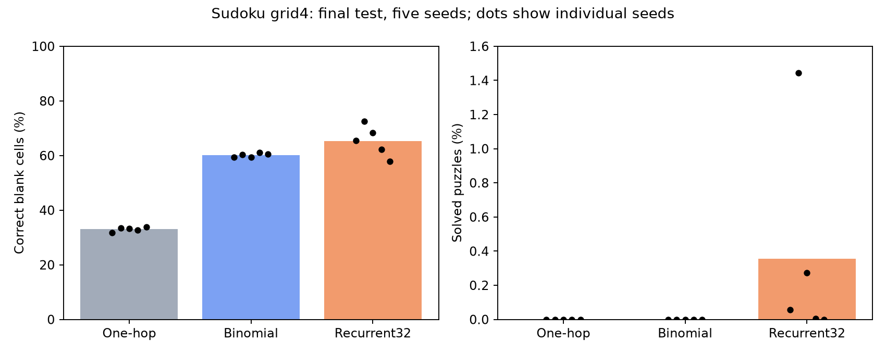
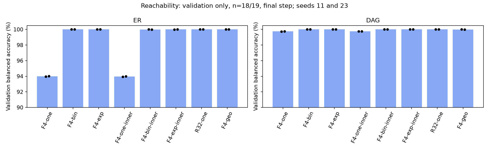

# Sudoku и directed reachability: результаты на 12 октября 2026 года

Снимок завершён 11 октября в 22:14:43 UTC, то есть **12 октября в 01:14:43 МСК**.
Публикация не останавливает обучение. Все приведённые ниже числа относятся
к этому снимку, а не к текущему состоянию очереди при открытии страницы.

## Статус и основные результаты

| Серия | Пилоты | Новые финальные обучения | Новые тестовые оценки | Статус |
|---|---:|---:|---:|---|
| Рекуррентные фильтры Sudoku | 12/12 | 5/5 по изменённому плану | 5/5 | Завершена; исходный план по пяти seeds сокращён |
| Sudoku с локальной маской grid4 | 18/18 | 15/15 | 15/15 | Завершена |
| Directed reachability, ER/DAG | 48/48 | 33/80 | 0 | Обучается |

В Sudoku с локальной маской биномиальная модель правильно заполняет
60,14% пустых клеток против 33,02% у one-hop, однако обе модели решили
0% целых головоломок. Рекуррентная R32 достигает 65,29% по клеткам и
0,356% полностью решённых задач. Это финальные test-оценки по пяти seeds.

В reachability многошаговые модели достигают почти 100% balanced accuracy
на **validation с 18–19 вершинами**. У one-hop на ER около 93,98%.
Это ещё не результат переноса на большие графы: test ID/near/far, stress
и дополнительное число шагов на inference на момент снимка не оценены.

## Как устроены сравнения

One-hop использует один перенос `AV` на блок. Биномиальный фильтр смешивает
`A V, A² V, …, Aʳ V` с коэффициентами `C(r,k)/(2ʳ−1)`.
Экспоненциальный и геометрический фильтры имеют тот же предел r и другие
положительные нормированные коэффициенты; их средний индекс переноса
согласован с биномиальным. Внутри блока A фиксирована, но дифференцируема.
Следующий внешний блок вычисляет новое внимание.

У recurrent один общий блок повторяется T раз, каждый раз пересчитывая
внимание и применяя внешний FFN. Это другая архитектура, а не одна степень
неизменной матрицы A. Inner MLP добавляет нелинейное преобразование между
переносами внутри блока и увеличивает параметры и вычисления.

Все новые финальные обучения стартуют с новой инициализацией и выполняют
30 000 обновлений, batch 64. В сравниваемых условиях фиксируются порядок
данных и общие начальные тензоры при одинаковом seed. Checkpoint выбирается
по validation, test не используется для выбора гиперпараметров.

## Sudoku с локальной маской: полный финальный результат

Данные — Sudoku-Hard: 180 000 train, 18 000 validation и 18 000 test.
У каждой клетки 38 входных признаков: исходная цифра, признак подсказки,
идентификаторы строки, столбца и квадрата. Решение и кандидаты solver
входными признаками не являются. Loss — CE только на исходно пустых клетках.
Decoder сохраняет подсказки и выбирает argmax для остальных клеток.
После decoding нет поиска, исправления ответа или solver.

В исходной relational-маске напрямую соединены клетки общей строки,
столбца или квадрата 3×3; диаметр графа равен 2. В grid4 остаются self-loop
и четыре ближайших соседа; диаметр равен 16. Изменяется только маска,
данные и признаки сохранены. Это одновременно меняет степень графа,
длину путей и соответствие связей правилам Sudoku; чистый эффект диаметра
из такого сравнения выделить нельзя.

Все модели имеют width 128 и 4 головы. F4 — четыре независимых блока;
R32 — 32 применения общего блока. У биномиальной F4 r=4, коэффициенты
`(4,6,4,1)/15`. Максимум последовательных переносов: 4, 16 и 32.
В этой Sudoku-серии внутреннего MLP нет.

Ниже **mean ± sample SD по пяти обучающим seeds**: 11, 23, 37, 53, 71.
Каждый seed оценён на одном и том же test из 18 000 задач.

| Модель | Верные пустые клетки, % | Полностью решённые задачи, % | Параметры | Обучение, с, среднее |
|---|---:|---:|---:|---:|
| F4-onehop | 33,016 ± 0,798 | 0,000 ± 0,000 | 797 449 | 280,6 |
| F4-binomial | 60,141 ± 0,778 | 0,000 ± 0,000 | 797 449 | 339,9 |
| R32-onehop | 65,287 ± 5,594 | 0,356 ± 0,619 | 204 169 | 1481,2 |

Время в таблице — накопленное время обновления весов, без validation,
checkpoint I/O и ожидания очереди. Среднее полное время вызова обучения:
535,6 / 613,3 / 2210,2 с соответственно. Счётчик завершённых выделений
основной очереди, включая профиль, обучение, оценки и накладные расходы:
**6,68 GPU-часа**. Исторические обучения и отдельные подготовительные
проверки вне этой очереди в данном счётчике не суммируются.



Точность пустых клеток и доля решённых задач имеют разные знаменатели.
Первая оценивает отдельные изначально пустые клетки, вторая требует,
чтобы все строки, столбцы и квадраты были корректны и подсказки сохранены.
Высокая первая метрика сама по себе не означает решения головоломки.

У R32 количество полностью решённых тестовых задач по seeds:
**10, 260, 49, 1, 0 из 18 000**. Поэтому среднее 0,356% сильно зависит
от seed; это не устойчивое высокое качество. Биномиальная улучшила
точность клеток на 27,125 п.п. относительно one-hop при одинаковом числе
параметров, но преимущества по основной метрике solved нет.

Совместимые исторические relational-контроли дают solved:
one-hop 5,493 ± 0,331%, binomial 5,228 ± 1,080%, R32 94,768 ± 0,367%.
Эти 15 результатов повторно не обучались; они помечены как historical.
Маска grid4 существенно ухудшила все три модели.

Заранее заданная разность разностей по solved:
`I=(binomial−onehop)_grid4−(binomial−onehop)_relational`
равна **+0,266 п.п.**, exploratory 95% paired-seed bootstrap CI
**[−0,538; +0,923] п.п.**. Интервал включает ноль; оснований утверждать
особое преимущество биномиального фильтра по полному решению нет.
При пяти seeds bootstrap имеет ограниченную точность.

Диагностика углов, границ и внутренних клеток выполнена отдельно на первых
64 validation-задачах и сохранена с числителями и знаменателями.
Она не заменяет полный test. Время inference batch1 и batch64 измерено
заново; batch time/64 не называется latency одного запроса.

## Рекуррентный биномиальный фильтр: сокращённая серия

Эта серия использует исходную relational-маску. Пользователь сократил её
до пяти новых финальных обучений, чтобы раньше запустить локальные маски.
Сохранены первые пять запусков исходной очереди: R16/B16 на seeds 11 и 23,
B32 на seed 11. Десять ещё не начатых финалов отмечены как пропущенные;
12 пилотов и пять исторических R32 сохранены. Решение принято после части
validation и до новых test-оценок, по порядку очереди, а не качеству.

| Модель | Новых финальных seeds | Test solved, % | Test blank accuracy, % |
|---|---:|---:|---:|
| R16 | 2 | 85,431 ± 0,043 | 97,661 ± 0,054 |
| B16, r=4 | 2 | 80,164 ± 0,255 | 97,135 ± 0,017 |
| B32, r=4 | 1 | 94,617; SD не определена | 98,817; SD не определена |
| R32, исторический контроль | 0 новых, 5 исторических | 94,768 ± 0,367 | 98,587 ± 0,084 |

B16 уступает R16 на **5,267 п.п.** в двух парных seeds. B32 уступает
R32 на **0,311 п.п.** в единственном общем seed 11. Сравнивать B32 seed11
со средним R32 по пяти seeds как парный эффект нельзя.
Эта сокращённая серия не выполняет первоначальную цель сравнения по пяти
новым seeds. Счётчик завершённых выделений основной очереди —
**4,923 GPU-часа**, без отдельного суммирования подготовительных проверок.

## Directed reachability: что уже известно

Сгенерированы два независимых семейства `er_exact_n_v1` и `dag_exact_n_v1`.
Всего **272 000 случайных графов и 2 176 000 запросов**, отдельно —
6000 stress-шаблонов с 12 000 парными positive/negative запросами.
На каждое семейство: 100 000 train-графов n=16–17, 5000 validation n=18–19,
5000 test_ID n=16–17, 20 000 test_near n=20–27, по 2000 test_far n=32/64/128.
Восемь разных упорядоченных запросов на граф выбраны равномерно без
балансировки labels; все запросы одного графа находятся в одном split.

Это адаптация генераторов из [Transformers Meet Directed Graphs](https://proceedings.mlr.press/v202/geisler23a.html),
а не точная репликация опубликованных scores. Сохраняются все n вершин.
Метки рассчитывает directed BFS, направление проверено независимым
транзитивным замыканием. Внимание использует `I∨Bᵀ`: маркер источника
передаётся по направлению рёбер, ответ читается только в target.
Пять входных признаков: константа, source/target markers, логарифмы входящей
и исходящей степени. Расстояния, labels, component IDs и скрытый DAG rank
не передаются в forward. Глобального pooling и virtual token нет.

Проверки: 36 CPU-тестов, 18 GPU-smoke условий и 9 overfit архитектур;
сохранение и восстановление optimizer/scheduler/RNG проверено.
Аудит не нашёл точных межсплитовых дублей adjacency. Полный точный разбор
WL-кандидатов нашёл изоморфную train-топологию у **3/5000 ER ID-test**
и **610/5000 DAG ID-test (12,2%)**. Данные после аудита не менялись.
ID-test нельзя трактовать как полностью независимые новые топологии;
near/far имеют другие n.

Профилирование полной сетки с резервом 20% дало 25,34 GPU-часа плюс уже
выполненные проверки. В потолок 24 GPU-часа допущены 8 моделей, обе семьи
и все пять финальных seeds: **48 пилотов + 80 финалов**. F4-learned
оставлен в плане продолжения; оценка необходимого повышения потолка
для полного плана — около 1,41 GPU-часа. Это прогноз, не разрешение
повысить бюджет. Решение о составе принято до новых test scores.

На момент снимка закончены 32 LR-пилота и 16 подтверждающих пилотов.
Завершено 33 финальных обучения. Для симметричного сравнения ниже взяты
**два полных раунда seeds 11 и 23**. Дополнительный завершённый ER one-hop
seed37 сохранён в per-seed CSV, но не добавлен только к одной строке сводки.

**Это validation BA после 30 000 обновлений, n=18–19, mean ± sample SD;
не test и не качество на n=32/64/128.**

| Модель | ER validation BA, % | DAG validation BA, % |
|---|---:|---:|
| F4-one | 93,9834 ± 0,0513 | 99,7511 ± 0,0176 |
| F4-bin | 99,9985 ± 0,0021 | 100,0000 ± 0,0000 |
| F4-exp | 100,0000 ± 0,0000 | 100,0000 ± 0,0000 |
| F4-one-inner | 93,9635 ± 0,0345 | 99,7636 ± 0,0000 |
| F4-bin-inner | 99,9927 ± 0,0104 | 100,0000 ± 0,0000 |
| F4-exp-inner | 99,9941 ± 0,0041 | 100,0000 ± 0,0000 |
| R32-one | 100,0000 ± 0,0000 | 100,0000 ± 0,0000 |
| F4-geo | 99,9985 ± 0,0021 | 99,9938 ± 0,0088 |



На ER виден разрыв между одношаговыми и многошаговыми моделями.
Inner MLP пока не даёт явного прироста относительно соответствующего
линейного фильтра; сильные модели почти насыщают эту validation-метрику.
По двум seeds и почти предельному качеству нельзя установить преимущество
биномиальной формы над экспоненциальной или геометрической.

Число параметров: 792 193 у F4 без inner MLP, 925 313 с inner MLP,
198 913 у R32. Среднее время обновления весов завершённого ER-финала:
one-hop 323 с, binomial 370 с, exponential 389 с, binomial+MLP 651 с,
R32 1527 с. Это разные архитектуры и бюджеты; equal-wall-time обучения
в эту серию не добавлялись. Накопленный учёт завершённых GPU-слотов
на снимке — 7,476 часа, активный слот будет добавлен после завершения.

Остаются 47 финальных обучений, затем фиксация всех выбранных checkpoints,
основной test ID/near/far и stress, отдельный extra-compute evaluation,
degree-only и другие диагностические baseline. Поэтому пока нет ответа
о переносе на большие n, длинные пути или пользе дополнительных inference
steps. Рабочая очередь использует одну GPU и слоты до 30 минут с resume.

## Проверяемость публикации и воспроизведение

Публикуются все завершённые records снимка: configs, result/evaluation JSON,
validation-кривые, manifests, hashes, малые таблицы и графики. Активное
обучение представлено отдельным статусом; его промежуточные веса не копируются.
Исходные данные, checkpoints, сырые predictions и приватные настройки
в GitHub не загружаются. Исторические и новые результаты не объединяются
в число новых обучений. Нули, отрицательные результаты и отдельные seeds
сохранены.

Отдельный CPU-аудит проверяет **360 000 сохранённых Sudoku test-предсказаний**
20 новых финалов: исходные IDs, правила строк/столбцов/квадратов,
сохранение clues, exact match и blank accuracy. Проверяется metadata
выбранных checkpoint. Повторный inference по этим весам в данном аудите
не выполняется. Проверка публикации заново сверяет config/source/data
hashes, выбор checkpoint по validation, все кривые и таблицы.
Свидетельства: [prediction audit](results/updates_20261012/prediction_audit.json)
и [publication validation](results/updates_20261012/publication_validation.json).

Код серий сохраняется в отдельных ветках, поскольку исходные функции
source hash включают полный набор файлов проекта. Их объединение изменило
бы архивные хеши. Коммиты и хеши файлов закреплены в
[source provenance](results/updates_20261012/source_provenance.json):

- [Рекуррентные фильтры](https://github.com/Kilkaintomat/binomial-attention-experiments/tree/recurrent_filter_sudoku_v1), включая отдельное изменение `final_cap_5`.
- [Локальная маска Sudoku](https://github.com/Kilkaintomat/binomial-attention-experiments/tree/sudoku_local_mask_v1).
- [Directed reachability](https://github.com/Kilkaintomat/binomial-attention-experiments/tree/directed_reachability_v1).

Для воспроизведения обучения используйте указанную ветку/commit и её README.
Отчёты подготовки в ветках являются архивными; текущий снимок находится
в этом документе. Для повторного построения таблиц и рисунков из main:

```bash
python scripts/build_current_series_assets.py
```

Выполнять внутри CPU allocation с зависимостями проекта. Приватный аудит
`scripts/audit_current_sudoku.py` дополнительно требует исходных prediction
массивов, выбранных checkpoint и пути к test cache; публичный checkout их
не содержит. Отсутствующие файлы не заменяются имитацией аудита.

Подробные таблицы: [локальный Sudoku по seeds](results/updates_20261012/tables/local_mask_test_per_seed.csv),
[рекуррентный Sudoku по seeds](results/updates_20261012/tables/recurrent_test_per_seed.csv),
[графы — только validation](results/updates_20261012/tables/reachability_final_validation_per_seed.csv),
[пилоты отдельно](results/updates_20261012/tables/pilots_validation.csv).
Первичные runtime-отчёты сохранены внутри снимка; их ранние формулировки
статуса не переопределяют проверенные counts и дату этой публикации.
